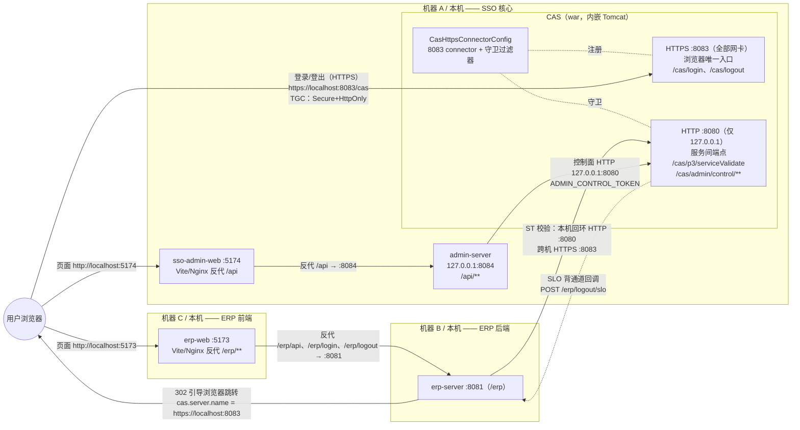
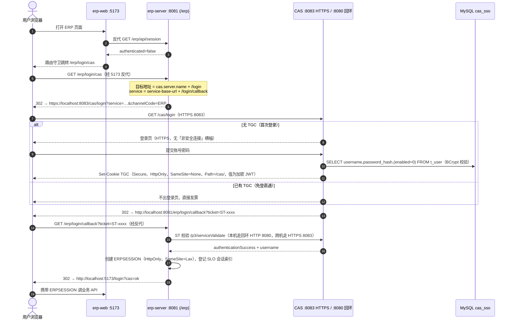
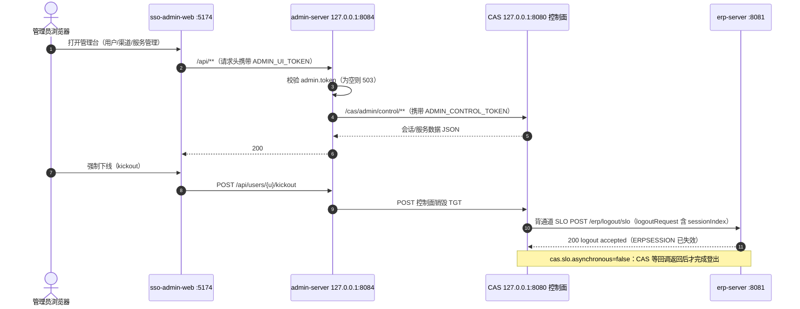

# CAS HTTPS 启用方案（自签证书 · 双端口 · 已落地）

> 目标：消除登录页「您目前正在通过非安全连接访问CAS……」横幅，让 SSO Cookie（TGC）获得完整安全加固，
> 同时**不改动** erp-server、admin-server、两个前端与 demo 客户端的任何代码。
>
> 本文以 2026-10-24 落地后的项目现状为准重写（原初稿中「8080 HTTPS / 8081 HTTP」的端口规划已被
> 实施时的更优方案取代，两套口径统一为下文的最终架构）。文中所有 YAML/Java/脚本均与仓库当前代码一致。

## 目录

- [背景与问题](#背景与问题)
- [最终架构与端口角色（已落地）](#最终架构与端口角色已落地)
- [影响面评估](#影响面评估)
- [证书生成：完整 cmd 脚本与命令](#证书生成完整-cmd-脚本与命令)
- [HTTPS 集成后每个配置的解析](#https-集成后每个配置的解析)
- [启动与验收](#启动与验收)
- [浏览器 HTTP 访问禁令（应用层守卫）](#浏览器-http-访问禁令应用层守卫)
- [三机部署拓扑（生产姿态）](#三机部署拓扑生产姿态)
- [常见问题（FAQ）](#常见问题faq)
- [Mermaid 流程图与调用关系](#mermaid-流程图与调用关系)
- [回退方案](#回退方案)
- [踩坑记录](#踩坑记录)
- [生产化替换清单](#生产化替换清单)

---

## 背景与问题

CAS 登录页右上角的「非安全连接」横幅来自 CAS 内置模板：

- 模板：`cas-server-support-thymeleaf-7.3.8.3.jar!/templates/fragments/header.html`
  - `<div class="cas-notification-message" th:unless="${httpRequestSecure}">`
  - `${httpRequestSecure}` 即 Servlet 的 `request.isSecure()`，HTTP 请求恒为 false，横幅必现。
- 文案：同 jar 内 `messages_zh_CN.properties`
  - `screen.nonsecure.message=您目前正在通过非安全连接访问CAS，单点登录将不起作用，您必须通过HTTPS登录。`

「单点登录将不起作用」的含义：TGC（TGT Cookie）在 HTTPS 下才能带 `Secure` 标志并加密签名；
HTTP 明文传输时浏览器会限制其跨站携带，SSO「免登直通第二个系统」的核心体验不可靠。

方案定型前 [application.yml](src/main/resources/application.yml) 曾是本地调试模式
（`sso.ssl.enabled: false`、`cas.tgc.secure: false`、`crypto.enabled: false`）；
**现已全部按本文配置切换为 HTTPS + TGC 加密签名**。

---

## 最终架构与端口角色（已落地）

### 端口角色表（实测生效）

| 端口 | 协议 | 绑定 | 角色 | 调用方 |
|---|---|---|---|---|
| **8080** | HTTP | **仅 `127.0.0.1`** | 服务间调用 + 脚本探活 | admin-server 控制面代理（同机）、bin 脚本探活、本机 erp-server（可选回环直连） |
| **8083** | **HTTPS** | 全部网卡 | **浏览器唯一入口** + 跨机服务调用 | 用户浏览器、跨机的 erp-server 票据校验 |
| 8081 | HTTP | `127.0.0.1`（代码预留，默认关） | `sso.debug.http-*` 本机调试口 | 仅排障时打开 |

### 关键设计：为什么「8080 保持 HTTP、HTTPS 用新端口 8083」

- erp-server 默认 `http://localhost:8080/cas`、demo 客户端（:9001/:9002）、服务注册表 JSON、
  bin 脚本探活 URL **全部原样工作**——把浏览器入口切到 8083 只影响「人」。
- 横幅与 TGC 安全只取决于**浏览器侧**连接协议；`/p3/serviceValidate`、`/cas/admin/control/**`
  属于服务端到服务端调用，不经过浏览器，回环明文的 TLS 价值为零。
- 网络层再加一层：8080 绑定 `127.0.0.1`，跨机流量被物理拒绝，杜绝 ST（服务票据）明文跨网。
- 若坚持「浏览器必须 8080」：把 HTTPS connector 绑 8080、HTTP 绑 8081 即可，
  但 erp-server（`CAS_BASE_URL`）、demo、探活脚本全部要改 URL——收益不抵改动量。

### 组件与交付物

| 组件 / 文件 | 状态 | 说明 |
|---|---|---|
| [application.yml](src/main/resources/application.yml) | ✅ 已改 | `server.address: 127.0.0.1`；新增 `sso.https.*`；`cas.server.name` → `https://localhost:8083`；`cas.tgc.secure/crypto: true` |
| [CasHttpsConnectorConfig.java](src/main/java/org/apereo/cas/config/CasHttpsConnectorConfig.java) | ✅ 新增 | `WebServerFactoryCustomizer`：追加 HTTPS :8083 connector（`SSLEnabled=true` + `SSLHostConfig` + keystore.p12）；keystore 缺失时 WARN 跳过不阻断启动；注册浏览器守卫过滤器 |
| [CasHttpBrowserGuardFilter.java](src/main/java/org/apereo/cas/config/CasHttpBrowserGuardFilter.java) | ✅ 新增 | HTTP 上的浏览器端点一律 302 升级到 HTTPS 入口（见[守卫](#浏览器-http-访问禁令应用层守卫)） |
| [pom.xml](pom.xml) | ✅ 已改 | `tomcat-embed-core 11.0.24`（provided，仅编译）——**版本必须与运行时 Tomcat 一致** |
| `META-INF/spring/...AutoConfiguration.imports` | ✅ 新增 | 注册 `CasHttpsConnectorConfig` |
| [bin/env.example.cmd](bin/env.example.cmd) / `bin/env.cmd` | ✅ 已改 | `CAS_KEYSTORE_PASSWORD`、TGC 密钥、三令牌模板 |
| `etc/cas/keystore.p12` / `localhost.cer` | ✅ 新增 | 自签证书（SAN=DNS:localhost，5 年，密码 changeit）；**已被 [.gitignore](.gitignore) 排除，不入 git** |
| erp-server / admin-server / erp-web / sso-admin-web / demo | ❌ 零改动 | 跨机场景仅需环境变量注入（见[三机部署](#三机部署拓扑生产姿态)） |

---

## 影响面评估

| 模块 | 是否改动 | 说明 |
|---|---|---|
| CAS `application.yml` | ✅ | 见[配置解析 §5.1](#51-cas--srcmainresourcesapplicationyml-逐项解析) |
| CAS 配置类 ×2 | ✅ | HTTPS connector + 浏览器守卫 |
| 证书 keystore.p12 | ✅ 新增 | 生成脚本见[§4](#证书生成完整-cmd-脚本与命令) |
| erp-server | ❌ 代码零改动 | 本机默认回环 HTTP 即可；跨机/生产注入 `CAS_BASE_URL=https://<cas-host>:8083/cas` + JVM 导入证书 |
| admin-server | ❌ 零改动 | `ADMIN_CONTROL_BASE` 保持回环 HTTP 8080（必须与 CAS 同机） |
| erp-web / sso-admin-web | ❌ 零改动 | 前端不直连 CAS；跳 CAS 的地址来自后端 302（跟随 `cas.server.name`） |
| 服务注册表 JSON | ❌ 零改动 | `serviceId` 匹配**业务系统回调地址**（`http://localhost:8081/erp/...`），与 CAS 自身协议无关 |
| bin 脚本 | ⚠️ 已调整 | 探活改探 `http://127.0.0.1:8080/cas/p3/serviceValidate`（守卫会让 `/cas/login` 恒 302，不能作为就绪判据）；8083 仅告警不阻断 |
| 浏览器 | ⚠️ 一次性 | 导入自签证书到「受信任的根证书颁发机构」 |

---

## 证书生成：完整 cmd 脚本与命令

### 4.1 一键脚本 `bin\gen-cas-cert.cmd`（推荐，完整版）

> 用法：项目根目录执行 `bin\gen-cas-cert.cmd`。
> 产物：`etc\cas\keystore.p12`（CAS 用）+ `etc\cas\localhost.cer`（分发/导入信任用）。
> 注意：**cmd 批处理注释必须纯 ASCII**（GBK codepage 下 UTF-8 中文注释会产生乱码字节，
> 可能形成 `|` 等元字符触发批解析错误——见[踩坑 6](#踩坑记录)），中文说明写在本文档里。

```bat
@echo off
setlocal EnableExtensions

rem ================================================================
rem  gen-cas-cert.cmd - generate the self-signed certificate for the
rem  CAS HTTPS entry (port 8083). ASCII comments ONLY in this file.
rem
rem  Outputs (relative to repo root):
rem    etc\cas\keystore.p12   - PKCS12 keystore used by CAS
rem    etc\cas\localhost.cer  - public cert for trust import
rem
rem  Requirements: PowerShell 5.1+ (built into Windows) and JDK 21
rem  (JAVA_HOME) for keytool verification.
rem ================================================================

rem ---- parameters (edit here if needed) ----
set "ALIAS=cas-localhost"
set "PASSWORD=changeit"
set "VALIDITY_YEARS=5"
set "IMPORT_TRUST=1"
set "IMPORT_JVM=0"

for %%I in ("%~dp0..") do set "ROOT=%%~fI"
set "KEYSTORE=%ROOT%\etc\cas\keystore.p12"
set "CER_OUT=%ROOT%\etc\cas\localhost.cer"

if not exist "%ROOT%\etc\cas" mkdir "%ROOT%\etc\cas"

set "KT=keytool"
if defined JAVA_HOME if exist "%JAVA_HOME%\bin\keytool.exe" set "KT=%JAVA_HOME%\bin\keytool.exe"

echo [1/4] creating self-signed certificate (SAN=dns:localhost) ...
powershell -NoProfile -ExecutionPolicy Bypass -Command ^
  "$ErrorActionPreference='Stop';" ^
  "$sec = ConvertTo-SecureString -String '%PASSWORD%' -Force -AsPlainText;" ^
  "$old = Get-ChildItem Cert:\CurrentUser\My | Where-Object { $_.Subject -eq 'CN=%ALIAS%' };" ^
  "if ($old) { $old | Remove-Item; Write-Host 'removed old %ALIAS% cert' }" ^
  "$c = New-SelfSignedCertificate -DnsName 'localhost' -Subject 'CN=%ALIAS%' -FriendlyName 'CAS localhost (self-signed)' -KeyExportPolicy Exportable -KeySpec KeyExchange -KeyLength 2048 -CertStoreLocation 'Cert:\CurrentUser\My' -NotAfter (Get-Date).AddYears(%VALIDITY_YEARS%);" ^
  "Export-PfxCertificate -Cert $c -FilePath '%KEYSTORE%' -Password $sec | Out-Null;" ^
  "Export-Certificate -Cert $c -FilePath '%CER_OUT%' -Type CERT | Out-Null;" ^
  "Write-Host ('[ok] keystore ' + '%KEYSTORE%');" ^
  "Write-Host ('[ok] cert ' + '%CER_OUT%');" ^
  "Write-Host ('[ok] thumbprint ' + $c.Thumbprint)"
if errorlevel 1 goto ps_failed

echo [2/4] verifying keystore with keytool ...
"%KT%" -list -keystore "%KEYSTORE%" -storetype PKCS12 -storepass "%PASSWORD%" 2>&1 | findstr /C:"PrivateKeyEntry" >nul
if errorlevel 1 goto keytool_failed

if "%IMPORT_TRUST%"=="1" (
  echo [3/4] importing into CurrentUser Root ^(browser trust, confirm the popup^) ...
  powershell -NoProfile -ExecutionPolicy Bypass -Command "Import-Certificate -FilePath '%CER_OUT%' -CertStoreLocation Cert:\CurrentUser\Root | Out-Null; Write-Host '[ok] imported to CurrentUser\Root'"
  if errorlevel 1 goto trust_failed
) else (
  echo [3/4] skipping browser trust import ^(IMPORT_TRUST=0^)
)

if "%IMPORT_JVM%"=="1" (
  echo [4/4] importing into JVM cacerts for server-to-server TLS ...
  "%KT%" -importcert -trustcacerts -alias %ALIAS% -file "%CER_OUT%" -cacerts -storepass changeit -noprompt
  if errorlevel 1 goto jvm_failed
) else (
  echo [4/4] skipping JVM cacerts import ^(IMPORT_JVM=0, needed only for HTTPS serviceValidate^)
)

echo.
echo [done] next steps:
echo   1. bin\env.cmd : set CAS_KEYSTORE_PASSWORD=%PASSWORD%
echo   2. bin\start-cas.cmd, then open https://localhost:8083/cas/login
echo   3. regenerate later: just re-run this script and restart CAS
endlocal & exit /b 0

:ps_failed
echo [error] PowerShell certificate creation failed. See messages above.
endlocal & exit /b 1

:keytool_failed
echo [error] keystore verification failed - wrong password or corrupt PKCS12.
endlocal & exit /b 1

:trust_failed
echo [warn] trust import failed; the browser will show a one-click warning instead.
endlocal & exit /b 0

:jvm_failed
echo [warn] JVM cacerts import failed; keep HTTP base-url or import manually.
endlocal & exit /b 0
```

脚本要点解析：

| 片段 | 作用 |
|---|---|
| `-DnsName 'localhost'` | 写入 **SAN（Subject Alternative Name）**。无 SAN 的老式证书会被现代浏览器以 `ERR_CERT_COMMON_NAME_INVALID` 拒绝，导入受信任根也没用 |
| 先删 `CN=%ALIAS%` 旧证书再创建 | 避免个人证书库随重建无限累积旧指纹 |
| `Export-PfxCertificate` → keystore.p12 | PKCS12 容器，CAS `SSLHostConfigCertificate` 以 `setCertificateKeystoreType("PKCS12")` 读取 |
| `Export-Certificate` → localhost.cer | DER 公钥证书，供浏览器/JVM 信任导入与跨机分发（**私钥不出 keystore**） |
| `IMPORT_TRUST` | `=1` 导入当前用户「受信任的根证书颁发机构」（弹窗点确认）；需免弹窗/全机生效时以管理员运行并把存储位置改为 `Cert:\LocalMachine\Root` |
| `IMPORT_JVM` | `=1` 时把证书导入 JDK `cacerts`，供本机 JVM（如 erp-server 走 HTTPS 校验票据）建立 PKIX 信任 |
| `keytool -list` 复核 | 确认 PKCS12 可读、含 `PrivateKeyEntry`，密码与 `CAS_KEYSTORE_PASSWORD` 一致 |

### 4.2 纯 keytool 替代方案（无 PowerShell，JDK 自带）

```bat
"%JAVA_HOME%\bin\keytool" -genkeypair -alias cas-localhost -keyalg RSA -keysize 2048 ^
  -validity 1825 -ext "SAN=dns:localhost" -dname "CN=cas-localhost" ^
  -keystore etc\cas\keystore.p12 -storetype PKCS12 -storepass changeit

"%JAVA_HOME%\bin\keytool" -exportcert -rfc -alias cas-localhost ^
  -file etc\cas\localhost.cer -keystore etc\cas\keystore.p12 ^
  -storetype PKCS12 -storepass changeit
```

#### 命令 1：`-genkeypair` —— 生成「私钥 + 自签证书」并锁进 p12

**作用**：一次性完成三件事——①生成一对非对称密钥（私钥+公钥）；②因为没有 CA，
用私钥给公钥签发一张**自签证书**（签发者=使用者）；③把两者打包写进
`etc\cas\keystore.p12` 这一个文件。

**产物**：仅一个文件 `keystore.p12`，内含一个条目（别名 `cas-localhost`）= 私钥 + 自签证书。
**此时还没有 .cer 文件**——证书在 p12 里面。

| 参数 | 解析 |
|---|---|
| `keytool` | JDK 自带工具，不依赖 PowerShell/Windows 证书库，任何 OS 结果一致（这就是它作为「无 PowerShell 替代方案」的原因） |
| `-genkeypair` | 子命令：生成密钥对并立即自签一张证书，二者存为同一别名下的一个条目 |
| `-alias cas-localhost` | 条目在 keystore 内的唯一名字，后续 `-exportcert`/`-list` 都靠它定位。**同别名重跑会覆盖旧条目**（4.1 脚本先删旧证书是同样的卫生目的） |
| `-keyalg RSA` | 密钥算法。浏览器与 JSSE 握手时兼容性最广的选择 |
| `-keysize 2048` | 密钥长度。1024 已破解淘汰；4096 握手更慢、收益可忽略——2048 是当前基线 |
| `-validity 1825` | **证书**有效期，单位天（1825 ≈ 5 年，对应 PowerShell 的 `.AddYears(5)`）。注意过期的是证书不是私钥；到期=握手被拒，重跑即可 |
| `-ext "SAN=dns:localhost"` | **最关键参数**：X.509 扩展「主体备用名称」写入 `DNS:localhost`。现代浏览器（Chrome 58+）完全不看 CN、只按 SAN 匹配访问域名，缺 SAN 必报 `ERR_CERT_COMMON_NAME_INVALID`，导信任也没用。等价于 PowerShell 的 `-DnsName` |
| `-dname "CN=cas-localhost"` | 证书主体 DN。浏览器已不认 CN，这里只是人类可读标签（所以填别名）；自签 ⇒ 签发者 DN = 主体 DN。给了它 keytool 就不再交互式提问 |
| `-keystore etc\cas\keystore.p12` | 输出文件（不存在则创建）。相对路径按**启动工作目录**解析——CAS 侧 `sso.https.keystore` 也按同样规则解析，所以两边路径写法一致 |
| `-storetype PKCS12` | 容器格式。旧默认 JKS 是 Java 专用老格式；PKCS12 是行业标准（OpenSSL/浏览器/.NET 都能读，JDK 9+ 自身默认）。**必须与代码 `setCertificateKeystoreType("PKCS12")` 一致** |
| `-storepass changeit` | keystore 的加密密码。**谁有文件+这个密码，谁就能导出私钥**——所以它进 `bin/env.cmd` 的 `CAS_KEYSTORE_PASSWORD`，被 .gitignore 排除 |
| （未写 `-keypass`） | PKCS12 强制私钥密码=库密码，keytool 自动处理 |

#### 命令 2：`-exportcert` —— 从 p12 里「只抽公钥证书」另存 .cer

**作用**：读取 p12 中 `cas-localhost` 条目，把其中的**公钥证书部分**单独导出成文件。
私钥无法（也不应该）这样导出——它永远留在 keystore 里。

**产物**：`localhost.cer` —— 一张单独的 X.509 证书，只含公开数据：主体、签发者（=主体）、
有效期、公钥、SAN 扩展、签名。**无私钥**。

| 参数 | 解析 |
|---|---|
| `-exportcert` | 子命令：导出指定别名的证书（老文档里的 `-export` 是同一命令）。方向：读 `-keystore` → 写 `-file` |
| `-rfc` | 输出 **PEM** 格式（`-----BEGIN CERTIFICATE-----` 包裹的 Base64 文本）。不加则是二进制 DER——**同一张证书，两种编码**，浏览器/JVM 都认，PEM 胜在可读可 diff。对应 PowerShell 侧 `Export-Certificate`（默认 DER） |
| `-alias cas-localhost` | 从 keystore 里选哪个条目导出 |
| `-file etc\cas\localhost.cer` | 输出文件。`.cer` 就是「单张证书」的扩展名惯例（`.crt`/`.pem` 是同一东西的别名） |
| `-keystore` / `-storetype` / `-storepass` | 源 keystore 路径、格式、打开密码——与命令 1 严格对应。证书本身不是秘密，但 p12 是加密容器，**读它必须给密码** |

补充（沿用原要点）：

- `-ext SAN=dns:localhost` 是关键，等价于 PowerShell 的 `-DnsName`；
- `-validity 1825` ≈ 5 年；`-storetype PKCS12` 与代码中 `setCertificateKeystoreType("PKCS12")` 对应；
- 浏览器信任导入仍按 4.1 的 `Import-Certificate`（或双击 localhost.cer → 安装到「受信任的根证书颁发机构」）。

#### `.p12` 与 `.cer` 是什么

| | `keystore.p12` | `localhost.cer` |
|---|---|---|
| 本质 | PKCS#12 **容器**（加密的二进制档案） | 单张 X.509 证书（此处为 PEM 文本） |
| 内容 | **私钥 + 证书**（可再装整条链） | **只有证书**（公开数据） |
| 泄露后果 | 严重：可冒充 CAS 身份 | 无害：本来就是发给所有人验证的 |
| TLS 中的角色 | **服务端**出示，用于握手时证明身份 | **客户端**导入，用于建立信任（白名单） |
| 数量与位置 | 一份，只在 CAS | 任意多份拷贝，发往每个需要信任它的地方 |

类比：p12 = 身份证原件 + 私章；cer = 拿去给大家核对的复印件。

#### `.p12` 在配置中出现的所有位置（以及为什么配置里没有 `.cer`）

| # | 位置 | 引用形式 |
|---|---|---|
| 1 | [application.yml](src/main/resources/application.yml) | `sso.https.keystore: etc/cas/keystore.p12` + `keystore-password: ${CAS_KEYSTORE_PASSWORD:changeit}` |
| 2 | [CasHttpsConnectorConfig.java](src/main/java/org/apereo/cas/config/CasHttpsConnectorConfig.java) | `@Value("${sso.https.keystore:...}")` 读入后 `setCertificateKeystoreFile(...)`、`setCertificateKeystorePassword(...)`、`setCertificateKeystoreType("PKCS12")`，最终挂上 8083 connector 的 `SSLHostConfig` |
| 3 | `bin/env.cmd`（间接） | `CAS_KEYSTORE_PASSWORD` —— 不是指向文件，而是这把锁的密码 |
| 4 | [.gitignore](.gitignore)（排除性引用） | 防止私钥容器进 git |

**为什么不需要 .cer？三层原因：**

1. **TLS 握手服务端要的是私钥，.cer 给不了**。8083 握手时 CAS 必须用私钥完成身份证明
   （签名/解密），单独一张 .cer 没有私钥，配置了也无法服务 TLS。服务端消费的永远是
   「私钥+证书」这个原子组合 = keystore。
2. **证书本来就装在 p12 里**。命令 2 正是从 p12 里把证书**抽出来**的——
   p12 = 私钥 + 证书 ⊇ .cer。CAS 配了 p12 就自动包含证书；再配一个 .cer 等于同一张证书
   引用两次，纯冗余。（Tomcat 也可以配「裸 .key+.crt 文件对」，但 keystore 容器把密钥和
   证书原子锁定、单文件单密码管理，避免磁盘上密钥/证书错配的经典事故——这也是选
   PKCS12 容器的原因。）
3. **.cer 的消费方全在「客户端」一侧，而 CAS 是信任链的根，没有客户端可当**。
   `localhost.cer` 的用途只有两个：给浏览器导入受信任根（[§4.3](#43-信任导入速查)第一行）、
   给跨机 JVM 导入 cacerts（[§4.3](#43-信任导入速查)第三行）——这些都是「让别人相信 CAS」
   的动作。CAS 自己不需要相信任何人，它只需出示 p12。

一句话总结：**一次 `-genkeypair` 产生一个身份（一对密钥）；这个身份以 p12 形态活在服务端
（CAS 配置里），以 N 份 .cer 拷贝的形态走向所有客户端（浏览器/JVM 的信任导入）。
配置文件里只见 p12 不见 .cer，正是因为服务端要私钥、而 .cer 只是 p12 内容的公开投影。**

### 4.3 信任导入速查

| 消费方 | 命令 | 说明 |
|---|---|---|
| Windows 浏览器（Chrome/Edge） | `Import-Certificate -FilePath etc\cas\localhost.cer -CertStoreLocation Cert:\CurrentUser\Root` | 当前用户级，弹窗确认；管理员 + `LocalMachine\Root` 可全机免弹窗 |
| Firefox | 设置 → 隐私与安全 → 证书 → 导入 localhost.cer | Firefox 用独立证书库 |
| **机器 B 的 JVM（erp-server 跨机 HTTPS 校验）** | **`$JAVA_HOME/bin/keytool -importcert -trustcacerts -alias cas-localhost -file localhost.cer -cacerts -storepass changeit -noprompt`** | **否则 PKIX path building failed** |
| 仅本机调试不导入 | 每次点「继续前往」 | 可用，但部分浏览器会限制不受信来源的 Cookie，消横幅与 SSO 加固打折扣——**建议导入** |

#### 为什么「机器 B 的 JVM」必须导入？执行前后流程与「公钥用来加密吗」

**为什么是 JVM 而不是 erp-server 的代码？** erp-server 校验 ST 用的是 JDK 内置
`HttpClient`（[CasAuthService.java](erp-server/src/main/java/com/example/erp/service/CasAuthService.java)），
它发起 HTTPS 连接时由 **JSSE（JDK 内置 TLS 实现）** 负责 TLS。JSSE 校验服务端证书的唯一
依据是 `$JAVA_HOME/lib/security/cacerts` 这个信任库——erp-server 自己的 application.yml
没有、也不该有证书配置。所以这条命令导的是 **JVM 的全局信任库**，导入一次，机器上所有
JDK 项目共享（见 [FAQ-2](#faq-2证书要配置在-cas-还是每个新系统项目里)）。

**自签证书为什么必然失败？** 正常证书的信任链：`服务器证书 → 中间 CA → 根 CA`，
根 CA 预置在 cacerts 里，链能走到根即通过。自签证书的签发者就是自己——`服务器证书 → ???`，
链的第一步就断了：cacerts 里没有 `cas-localhost` 这个锚点，JSSE 抛
`PKIX path building failed`，握手在交换任何 HTTP 字节**之前**终止。

**执行前（未导入）——每次登录的失败时序：**

```
1. 浏览器 → CAS 登录（HTTPS 8083）        ✅ 浏览器有自己的信任库（已导入 cer），与 JVM cacerts 无关
2. CAS 302 回 /erp/login/callback?ticket  ✅ 正常
3. erp-server（JSSE）→ CAS:8083 TCP 连接  ✅ 网络可达
4. CAS 出示证书（ServerHello+Certificate）✅ 服务端总能出示
5. JSSE 到 cacerts 里找「签发者锚点」      ❌ 找不到 → PKIX path building failed
6. 连接被客户端主动关闭，HTTP 请求根本没发出去
7. CasAuthService 捕获 → fail("CAS 校验请求失败：PKIX…")
8. 用户被 302 回 /login?cas=fail —— 账号密码明明是对的
```

**执行后（已导入）——同一路径变为：**

```
1-4. 与上面完全相同
5. JSSE 在 cacerts 里命中 alias cas-localhost → 该证书本身即受信锚点，链验证通过
6. （校验证书未过期、SAN 匹配域名）→ 继续密钥协商 → 握手完成
7. HTTP GET /p3/serviceValidate?ticket=ST-xxx 正常发出
8. CAS 返回 authenticationSuccess + username → ERP 建立会话
```

即：**导入改变的只有第 5 步**——cacerts 从「查无此人」变成「白名单命中」。
命令参数对应关系：`-trustcacerts` 表示除 cacerts 内置 CA 外同时信任导入的条目；
`-alias cas-localhost` 给信任条目起名（便于日后 `-delete` 替换）；`-cacerts` 目标库；
`-noprompt` 免交互（指纹确认由 `-fingerprint` 人工核对替代，内网分发场景常用）。

**「客户端需要用这里的公钥来加密吗？」——不需要，这是最常见的误解。**

导入 cacerts 的作用**不是给客户端一把「加密钥匙」，而是给客户端一份「身份比对底样」**：

- **公钥的真实用途：验签（身份认证）**。TLS 握手时 CAS 用自己的私钥对握手内容签名，
  JSSE 用证书里的公钥验证签名——证明「对面确实是持有这张证书对应私钥的服务器」，
  而不是伪造者。这是公钥在本流程中的唯一用途。
- **真正加密数据的钥匙不是这张证书的公钥**。本项目启用 TLSv1.2/1.3，密钥协商走
  **ECDHE（临时椭圆曲线 Diffie-Hellman）**：浏览器/erp-server 与 CAS 各出一个临时参数，
  现场协商出**对称会话密钥**（AES-GCM 等），应用数据全部用它加密。证书公钥从不接触
  业务数据的加密；会话密钥每次连接都是新的，且不出现在任何证书里。
- **「用证书公钥加密数据、服务端私钥解密」是 TLS_RSA 交换模式**，已在 TLS 1.3 中被
  淘汰禁用（无前向保密：私钥一旦泄露，历史流量全部可解）。
- 公钥本来就是公开的（浏览器访问 8083 时 CAS 主动把它发给任何人），所以导入 .cer
  不涉及任何保密操作——`.cer` 可以随意拷贝分发。

一句话：**客户端导入的不是「加密钥匙」，而是「信任锚」。加密靠 ECDHE 协商出的对称会话密钥，
导入的公钥只用来在握手时确认「对面的身份没被冒充」。** 这也解释了 [FAQ-3](#faq-3新系统跨机不执行-keytool-导入命令会怎样)
的现象：没导入时死在「身份确认」这步，连协商加密的资格都没有。

### 4.4 TGC 加密/签名密钥生成（一次性，写入 `bin\env.cmd`）

#### 命令本体（直接复制执行）

> 在任意 **cmd 窗口**逐条执行，输出即密钥值；**复制粘贴到 `bin\env.cmd` 对应变量后回车**
> ——没有文件产物，关窗即丢失。

```bat
rem ---- 256-bit encryption key -> paste into CAS_TGC_ENCRYPTION_KEY ----
powershell -NoProfile -Command "$b=[byte[]]::new(32);(New-Object Security.Cryptography.RNGCryptoServiceProvider).GetBytes($b);[Convert]::ToBase64String($b).TrimEnd('=').Replace('+','-').Replace('/','_')"

rem ---- 512-bit signing key -> paste into CAS_TGC_SIGNING_KEY ----
powershell -NoProfile -Command "$b=[byte[]]::new(64);(New-Object Security.Cryptography.RNGCryptoServiceProvider).GetBytes($b);[Convert]::ToBase64String($b).TrimEnd('=').Replace('+','-').Replace('/','_')"
```

期望输出（长度固定，可肉眼校验）：

```
第 1 条 → 43 字符，如：3zXk9Qm2vB7nR4tW8yU1cE6aP0oI5sD2fG9hJ3lK7mN0q
第 2 条 → 86 字符，如：4aB8cD2eF6gH1iJ3kL5mN9oP0qR7sT1uV4wX6yZ8aB0cD2eF4gH6iJ8kL0mN2oP4qR6sT8uV0wX2yZ4aB6cD8eF0gH2iJ4
```

> 放在 .ps1 脚本里执行时用双命令版（粘贴回显 + 提示变量名）：
>
> ```powershell
> $b=[byte[]]::new(32);(New-Object Security.Cryptography.RNGCryptoServiceProvider).GetBytes($b)
> $enc=[Convert]::ToBase64String($b).TrimEnd('=').Replace('+','-').Replace('/','_')
> $b=[byte[]]::new(64);(New-Object Security.Cryptography.RNGCryptoServiceProvider).GetBytes($b)
> $sig=[Convert]::ToBase64String($b).TrimEnd('=').Replace('+','-').Replace('/','_')
> "CAS_TGC_ENCRYPTION_KEY=$enc"; "CAS_TGC_SIGNING_KEY=$sig"
> ```
>
> 注意：`.ps1` 内不能写 `rem`（那是 cmd 注释语法），注释用 `#`。

#### 这 8 行在做什么 / 有什么作用 / 产生了什么 / 为什么要执行

**在做什么**：2 条 `rem` 注释 + 2 条 PowerShell 命令——为 TGC Cookie 的加密与签名各生成
一把随机密钥，以文本形式打印出来。**不生成任何文件**——产物就是屏幕上两行字符串，
由人复制进 `bin\env.cmd`。逐行拆解（以命令 1 为例，命令 2 完全同构、仅字节数不同）：

```powershell
$b=[byte[]]::new(32)                                  # ① 分配 32 字节 = 256 bit 的空数组
(New-Object Security.Cryptography.RNGCryptoServiceProvider)
    .GetBytes($b)                                     # ② 用操作系统密码学安全随机数填满它
[Convert]::ToBase64String($b)                         # ③ 编码成 Base64 文本（43 字符 + 1 个 = 填充）
    .TrimEnd('=')                                     # ④ 去掉填充符 =
    .Replace('+','-').Replace('/','_')                # ⑤ Base64 → Base64url：+ → -、/ → _
```

**三个关键设计点**：

| 设计 | 为什么必须这样 |
|---|---|
| **`RNGCryptoServiceProvider`（CSPRNG）** | 这两把密钥是整个 TGC 体系唯一的根秘密。必须用操作系统级**密码学安全随机源**；若用 `Get-Random`（可预测种子的伪随机数），攻击者可能推导出密钥 → 伪造任意用户的 TGC，整个 SSO 形同虚设 |
| **Base64url（`+/-`、`/_` 替换 + 去 `=`）** | 密钥要嵌进 YAML 和 cmd 环境变量：`+` `/` `=` 在 URL、YAML 值、批处理里都是特殊字符。Base64url 字母表对全部场景安全。这也是 CAS 对密钥格式的**硬性要求**（CAS 按此编码解析） |
| **32 / 64 字节精确长度** | 由 CAS 内部算法倒逼：加密密钥喂给 **AES-256**（必须 256-bit），签名密钥喂给 **HMAC-SHA-512**（必须 512-bit）。长度不对 → CAS 启动即报错，而不是悄悄降级 |

**产生了什么**：**没有文件，只有控制台输出**——一个 43 字符、一个 86 字符的 base64url
字符串。这是「一次性动作 + 人工入库」的设计：生成的值**必须立刻**粘贴到 `bin/env.cmd`
的这两行并保存（该文件已被 .gitignore 排除，不入 git），否则关掉窗口就永远找不回来。
（密钥丢了 = 所有已发会话作废，重新生成即可——加密的只是会话引用而非长期数据，无解密困境。）

**为什么要执行**：消费链路在 [application.yml](src/main/resources/application.yml)：

```yaml
cas.tgc.crypto:
  enabled: true
  encryption.key: ${CAS_TGC_ENCRYPTION_KEY:}   # ← 为空走默认值
  signing.key:    ${CAS_TGC_SIGNING_KEY:}
```

登录成功后，CAS 把 TGT（服务端会话对象）的引用做成 **TGC Cookie** 下发浏览器；
`crypto.enabled: true` 时这个 Cookie 值 = 用加密密钥加密、再用签名密钥做 HMAC 的 JWT 串
（即验收清单里看到的「值为加密 JWT 串」）。加密保证浏览器/中间人看不到也改不了里面的
TGT 引用；签名保证 CAS 收到的 TGC 一定是自己签发的。

**不执行（环境变量留空）的后果**：CAS 检测到密钥为空，每次启动**自动随机生成**并打
WARN——密钥值随重启变化：

1. **每次重启 = 全员掉线**：重启后 CAS 用新密钥解不开旧 TGC（解密失败/验签失败），
   所有已登录用户的 SSO 会话作废，被迫重新登录；
2. **多节点部署直接不可用**：节点 A 签发的 TGC，节点 B 读不懂——负载均衡下 SSO 退化成
   「每个节点各登一次」。

所以「生产必须固定」：本地开发图省事可以留空，但只要想「重启不掉线」（这正是启用
HTTPS + TGC 加固想保住的核心体验），这两条命令就是必做的一次性步骤。

一句话：**这 8 行是用密码学安全随机源「掷骰子」两次，把 256-bit 和 512-bit 的根秘密
编码成可安全嵌入配置的文本——它们决定了 TGC 能否跨重启、跨节点保持有效。**

### 4.5 验证、重建与到期

```bat
rem 1) keystore 内容与有效期
"%JAVA_HOME%\bin\keytool" -list -v -keystore etc\cas\keystore.p12 -storetype PKCS12 -storepass changeit | findstr /C:"Owner" /C:"Valid"

rem 2) CAS 启动后端口与 TLS 就绪（PS7 可加 -SkipCertificateCheck）
powershell -NoProfile -Command "try { Invoke-WebRequest -UseBasicParsing -Uri 'https://127.0.0.1:8083/cas/login' -TimeoutSec 3 } catch { $_.Exception.Message }"
```

- **重建**：重跑 4.1 脚本（自动清理旧证书）→ 无需改 CAS 配置 → 重启 CAS；
- **到期**：`keytool -list` 看到 `Valid from ... to` 即将到期即重建；
- 自签证书即自身根：重建后指纹变化，浏览器需重新信任一次（CA 签发则无此问题，见[生产化清单](#生产化替换清单)）。

---

## HTTPS 集成后每个配置的解析

### 5.1 CAS · [application.yml](src/main/resources/application.yml) 逐项解析

```yaml
server:
  port: 8080
  address: 127.0.0.1
  servlet:
    context-path: /cas
  ssl:
    enabled: false
```

| 配置键 | 当前值 | 解析（HTTPS 集成后） |
|---|---|---|
| `server.port` | `8080` | Spring Boot 内嵌 Tomcat **主 connector** 端口，协议 HTTP。承担服务间调用（票据校验、控制面）与脚本探活。角色与 HTTPS 化之前完全一致 |
| `server.address` | `127.0.0.1` | **网络层加固第一层**：主端口仅回环可达。跨机调用方（生产 erp-server）连 8080 会被拒绝，必须走 8083 HTTPS——ST 不再明文跨网 |
| `server.servlet.context-path` | `/cas` | 所有 CAS 端点前缀。两个联动：① servlet 过滤器的 url-pattern 匹配的是 **context 内路径**（`/cas` 已被剥离），守卫必须注册 `/*`；② erp-server 的 `erp.cas.base-url` 必须以 `/cas` 结尾 |
| `server.ssl.enabled` | `false` | **只管主 connector（8080）**。若改 true：8080 变 HTTPS → admin-server 控制面（`http://127.0.0.1:8080`）、探活脚本、本机 erp-server 全部握手失败。TLS 由自定义 connector 在 8083 承担，此项必须保持 false |

```yaml
sso:
  https:
    enabled: true
    port: 8083
    keystore: etc/cas/keystore.p12
    keystore-password: ${CAS_KEYSTORE_PASSWORD:changeit}
```

| 配置键 | 当前值 | 解析（HTTPS 集成后） |
|---|---|---|
| `sso.https.enabled` | `true` | `CasHttpsConnectorConfig` 的总开关。false 时退回纯 HTTP 模式（横幅回归、TGC 安全降级），用于首次无证书拉起 |
| `sso.https.port` | `8083` | HTTPS connector 端口，**绑定全部网卡**（代码未设 address）。三处联动必须一致：`cas.server.name` 里的端口、守卫过滤器 302 目标端口、`start-cas.cmd` 的 8083 探活 |
| `sso.https.keystore` | `etc/cas/keystore.p12` | 相对**工作目录**解析（`start-cas.cmd` 以项目根为 WorkingDirectory）。文件不可读时仅 WARN 并跳过 HTTPS connector，不阻断启动（代码故意为之，方便先拉 HTTP 再补证书） |
| `sso.https.keystore-password` | env `CAS_KEYSTORE_PASSWORD`，默认 `changeit` | 与证书生成时的导出密码一致；不一致 → connector 启动/TLS 握手失败。生产通过 env 注入，不落代码 |

```yaml
sso:
  datasource: {url/username/password/driver-class-name}
  service-dir: ${CAS_SERVICE_DIR:./etc/cas/services}
  admin:
    token: ${CAS_ADMIN_TOKEN:}
```

| 配置键 | 解析（HTTPS 集成后） |
|---|---|
| `sso.datasource.*` | 认证库 `cas_sso`（本机演示 CAS/admin/erp 共用一套库；生产建议拆分）。注意 URL 中 `useSSL=false&allowPublicKeyRetrieval=true` 是 **MySQL Connector/J 的 JDBC 连接参数**，与 CAS 自身 HTTPS 无关，不要混淆 |
| `sso.service-dir` | JSON 服务注册表目录；配合 `watcher-enabled` 热加载。注册表里的 `serviceId` 匹配的是业务系统回调地址，**HTTPS 化无需改规则**；跨机部署时才把 host 换成真实地址 |
| `sso.admin.token` | CAS 控制面（`/cas/admin/control/**`）的鉴权令牌。admin-server 必须持相同值（其 `ADMIN_CONTROL_TOKEN`）。为空 → 控制面 503 |

```yaml
cas:
  server:
    name: ${CAS_SERVER_NAME:https://localhost:8083}
    prefix: ${cas.server.name}/cas
```

| 配置键 | 当前值 | 解析（HTTPS 集成后） |
|---|---|---|
| `cas.server.name` | `https://localhost:8083` | **HTTPS 集成的枢纽配置**。CAS 生成一切对外 URL（登录页跳转、`service` 构造、logout 回跳）都以它为基准；erp-server `/erp/login/cas` 的 302 目标 = 它 + `/login`。改域名/端口只动 `CAS_SERVER_NAME`，**不改任何代码** |
| `cas.server.prefix` | `${cas.server.name}/cas` | 约定 = server.name + context-path；票据校验响应、SLO 报文中的 CAS 引用用它。两者必须同步改 |

```yaml
cas:
  tgc:
    secure: true
    crypto:
      enabled: true
      encryption:
        key: ${CAS_TGC_ENCRYPTION_KEY:}
      signing:
        key: ${CAS_TGC_SIGNING_KEY:}
```

| 配置键 | 当前值 | 解析（HTTPS 集成后） |
|---|---|---|
| `cas.tgc.secure` | `true` | TGC Cookie 带 `Secure` 标志。**这是必须走 HTTPS 登录的根本原因**：Secure Cookie 不能在明文 HTTP 连接上设置/携带。实测 F12 中 TGC 属性：`Secure; HttpOnly; SameSite=None; Path=/cas/` |
| `cas.tgc.crypto.enabled` | `true` | TGC 值加密 + 签名（实际形态为加密 JWT 串），防篡改、防伪造，浏览器侧不再出现明文 `TGT-xxxx` |
| `cas.tgc.crypto.encryption.key` | env `CAS_TGC_ENCRYPTION_KEY` | **256-bit（32 字节）base64url 无填充**加密密钥。为空 → 每次启动随机生成并 WARN → 重启后全部会话失效。多节点部署必须一致 |
| `cas.tgc.crypto.signing.key` | env `CAS_TGC_SIGNING_KEY` | **512-bit（64 字节）** 签名密钥，同上。生成命令见 [§4.4](#44-tgc-加密签名密钥生成一次性写入-binenvcmd) |

```yaml
cas:
  authn:
    accept:
      enabled: ${CAS_ACCEPT_AUTH:false}
    jdbc:
      query:
        - url/user/password/driver-class: 复用 sso.datasource
          sql: "SELECT username, password_hash, (enabled = 0) AS disabled FROM t_user WHERE username = ?"
          field-password: password_hash
          field-disabled: disabled
          password-encoder:
            type: BCRYPT
```

| 配置键 | 解析（HTTPS 集成后） |
|---|---|
| `cas.authn.accept.enabled` | 内置演示账号（casuser/Mellon）开关，默认 false；仅排障时临时打开，正常必须走 JDBC 认证 |
| `cas.authn.jdbc.query[0].sql` | 按 username 查 `t_user`；`(enabled = 0) AS disabled` 把禁用位映射为 CAS 的 disabled 字段（禁用即拒绝认证） |
| `field-password` + `password-encoder.type: BCRYPT` | 用 BCrypt 校验 `password_hash`。哈希与文档密码不匹配 → 401（曾踩坑，见[踩坑 4](#踩坑记录)） |

```yaml
cas:
  service-registry:
    core:
      init-from-json: true
    json:
      location: "file:${sso.service-dir}"
      watcher-enabled: true
  slo:
    disabled: false
    asynchronous: false
  logout:
    follow-service-redirects: true
```

| 配置键 | 解析（HTTPS 集成后） |
|---|---|
| `service-registry.core.init-from-json` + `json.location` | 启动时从 JSON 文件装载服务注册表 |
| `service-registry.json.watcher-enabled` | 监听注册表目录变化并热加载——管理台/手工改 `service-*.json` 后**无需重启 CAS** |
| `slo.disabled: false` | 单点登出（BACK_CHANNEL）开启：CAS 收到登出时向每个已注册服务的 `logoutUrl` 回调 |
| `slo.asynchronous: false` | **同步回调**：CAS 等业务系统返回后才完成登出，保证 erp 本地会话在请求返回前已失效；异步模式弱网下会漏杀会话 |
| `logout.follow-service-redirects: true` | 登出完成后按 `?service=` 跳回业务系统；仅对**已注册** service 生效，天然防开放跳转 |

### 5.2 CAS 配置类关键参数（[CasHttpsConnectorConfig.java](src/main/java/org/apereo/cas/config/CasHttpsConnectorConfig.java)）

| 代码参数 | 解析 |
|---|---|
| `https.setScheme("https")` / `setSecure(true)` | 让 `request.isSecure()` 返回 true——消横幅与 TGC Secure 的判定来源 |
| `https.setProperty("SSLEnabled", "true")` | **Tomcat 8.5+ 开启 TLS 的硬性开关**。缺失时 connector 仍按明文跑（曾踩坑 3：端口在、TLS 握手 `SEC_E_INVALID_TOKEN`） |
| `sslImplementationName=JSSEImplementation` | 显式指定 JSSE 实现，与 `SSLEnabled` 配套 |
| `SSLHostConfig.setProtocols("TLSv1.2,TLSv1.3")` | 允许的 TLS 版本 |
| `setCertificateKeystoreType("PKCS12")` | 与 4.1/4.2 生成的 keystore 格式对应 |
| keystore 缺失 → WARN + return | 证书缺失不阻断启动，保留纯 HTTP 模式 |
| `sso.debug.http-enabled`（默认 false） | 可选回环 HTTP 调试口 8081，仅排障 |
| Guard 过滤器 `addUrlPatterns("/*")` | servlet url-pattern 匹配 context 内路径（`/cas` 已剥离）；`shouldNotFilter` 只拦 `/login`、`/logout`（含子路径）且非 HTTPS 请求 |

### 5.3 erp-server · [application.yml](erp-server/src/main/resources/application.yml) 逐项解析

| 配置键 | 当前值 | 解析（HTTPS 集成后） |
|---|---|---|
| `server.port` / `context-path` | `8081` / `/erp` | 与服务注册表 `service-3001.json` 的 `serviceId` 正则 `^http://localhost:8081/erp/.*$` **强联动**：改端口必须同步改 JSON |
| `server.servlet.session.cookie.*` | `ERPSESSION`、`http-only`、`same-site: lax` | ERP 自己的**业务会话** Cookie。刻意未加 `secure`：本地调试浏览器经 `http://localhost:5173` 反代访问 `/erp`，加 Secure 会导致 Cookie 带不上；它是同站会话而非跨站 SSO 凭证，无 TGC 的跨站诉求 |
| `erp.channel-code` | `ERP` | 与注册表 `properties.channelCode` 匹配，`ChannelAccessStrategy` 据此做渠道准入 |
| `erp.service-base-url` | env `ERP_SERVICE_BASE_URL` | 构造 CAS 回调地址 = 它 + `/login/callback`，**必须落在 serviceId 正则内**，否则 CAS 判「未授权服务」 |
| `erp.frontend-base-url` | env `ERP_FRONTEND_BASE_URL` | 登录成功/失败后 302 回前端（`/login?cas=ok|fail`） |
| `erp.cas.base-url` | env `CAS_BASE_URL`，默认 `http://localhost:8080/cas` | **HTTPS 集成后唯一需要关心的 erp 配置**：本机默认回环 HTTP（明文不出本机，可接受）；跨机/生产注入 `https://<cas-host>:8083/cas`，且 JVM 必须信任 CAS 证书（[§4.3](#43-信任导入速查)），否则 `PKIX path building failed` |
| `erp.cas.validate-path` | `/p3/serviceValidate` | ST 校验端点。在守卫放行名单内（服务间端点），回环 HTTP 可用 |
| `erp.cas.http-timeout-seconds` | `5` | 校验请求超时；CAS 不可达时登录快速失败而非挂死 |

### 5.4 admin-server · [application.yml](admin-server/src/main/resources/application.yml) 逐项解析

| 配置键 | 当前值 | 解析（HTTPS 集成后） |
|---|---|---|
| `server.port` / `server.address` | `8084` / `127.0.0.1` | 控制面后端仅回环；对外只经 sso-admin-web 的反代暴露 |
| `admin.token` | env `ADMIN_UI_TOKEN` | 校验 sso-admin-web 请求头令牌；为空 → 全部 `/api/**` 503 |
| `admin.service-dir` | `../etc/cas/services` | 管理台直接读写 CAS 的注册表 JSON；CAS watcher 热加载 → 管理台改动即时生效 |
| `admin.control.base-url` | env `ADMIN_CONTROL_BASE`，默认 `http://127.0.0.1:8080/cas/admin/control` | 走 CAS **回环 HTTP 8080**：同机明文无窃听面，TLS 无增益；**因此 admin-server 必须与 CAS 同机部署** |
| `admin.control.token` | env `ADMIN_CONTROL_TOKEN` | 必须与 CAS 的 `sso.admin.token`（`CAS_ADMIN_TOKEN`）完全一致 |
| `admin.control.timeout-seconds` | `5` | 控制面代理超时 |

### 5.5 前端（零改动的原因）

| 文件 | 解析 |
|---|---|
| [erp-web/vite.config.js](erp-web/vite.config.js) | 仅 `/erp/api`、`/erp/login`、`/erp/logout` 反代到 `http://localhost:8081`；SPA 路由不进代理（否则命中后端 404→500）。**不直连 CAS**——跳 CAS 的地址来自 erp-server 的 302（跟随 `cas.server.name` → 自动落到 HTTPS 8083），所以 CAS 协议切换对前端透明 |
| [sso-admin-web/vite.config.js](sso-admin-web/vite.config.js) | `dev`/`preview` 均把 `/api` 反代到 `http://127.0.0.1:8084`，浏览器全程同源、无需 CORS；不直连 CAS，HTTPS 化无影响。生产由 Nginx 托管 dist 并反代 `/api` |

### 5.6 `bin\env.cmd` 环境变量总表

| 变量 | 消费方 | 作用 | 缺省/为空的后果 |
|---|---|---|---|
| `CAS_DB_PASSWORD` / `ADMIN_DB_PASSWORD` | CAS / admin-server | 数据库密码 | 启动失败（start-cas 有前置检查） |
| `CAS_ADMIN_TOKEN` | CAS | 控制面鉴权（`sso.admin.token`） | 控制面 503 |
| `ADMIN_UI_TOKEN` | admin-server | 校验 sso-admin-web 请求 | 全部 API 503 |
| `ADMIN_CONTROL_TOKEN` | admin-server → CAS | 必须等于 `CAS_ADMIN_TOKEN` | 控制面 401 |
| `CAS_KEYSTORE_PASSWORD` | CAS HTTPS connector | keystore.p12 密码 | 落默认值 `changeit` |
| `CAS_TGC_ENCRYPTION_KEY` / `CAS_TGC_SIGNING_KEY` | CAS | TGC 加密/签名密钥 | 每次启动随机生成，重启全员掉线 |
| `CAS_SERVER_NAME`（可选） | CAS | 覆盖 `cas.server.name` | `https://localhost:8083` |
| `CAS_BASE_URL`（erp 侧） | erp-server | 覆盖 `erp.cas.base-url` | `http://localhost:8080/cas` |

### 5.7 服务注册表 JSON（[service-3001.json](etc/cas/services/service-3001.json)）

| 字段 | 解析 |
|---|---|
| `serviceId: ^http://localhost:8081/erp/.*$` | 匹配**业务系统回调地址**（service 参数），与 CAS 自身 HTTP/HTTPS 无关——CAS 双协议下规则不用动；跨机部署把 host 换成 `<erp-b-host>:8081` |
| `logoutType: BACK_CHANNEL` + `logoutUrl` | CAS 单点登出的背通道回调目标（`/erp/logout/slo`） |
| `properties.channelCode` | 渠道码 `ERP`，与 erp-server 的 `erp.channel-code` 对应 |
| `accessStrategy: ChannelAccessStrategy` | 按渠道准入的自定义策略 |

---

## 启动与验收

### 启动顺序

```
bin\env.cmd（首次从 env.example.cmd 复制并填值）
  → bin\start-cas.cmd          # 先 SSO 核心：探活 http://127.0.0.1:8080/cas/p3/serviceValidate（任何响应=就绪）
                               #   8083 HTTPS 探活仅告警不阻断（无证书时允许 HTTP-only 运行）
  → bin\start-admin-server.cmd # 依赖 CAS 回环 8080
  → bin\start-admin-web.cmd    # 5174 → 8084
  → erp-server / erp-web       # 8081 / 5173（erp-web 后启动即可，无探活依赖）
```

> 探活为什么不是 `/cas/login`：守卫会让 HTTP 的 `/cas/login` 恒 302，`==200` 判据永远不满足，
> 60 次重试后误杀健康实例（曾连环踩坑两次）。`/p3/serviceValidate` 是服务间端点，任何响应都算就绪。

### 验收矩阵（2026-10-24 实测全部通过）

| # | 检查 | 期望 | 结果 |
|---|---|---|---|
| 1 | `https://localhost:8083/cas/login` | HTTP 200，无红警告、无「非安全连接」横幅 | ✅ |
| 2 | `http://localhost:8080/cas/login` | 302 → HTTPS 入口（守卫生效），服务间兼容 | ✅ |
| 3 | 浏览器 F12 → Cookie `TGC` | `Secure; HttpOnly; SameSite=None; Path=/cas/`，值为加密 JWT 串 | ✅ |
| 4 | alice / Passw0rd! HTTPS 登录 | 200 + Set-Cookie TGC | ✅ |
| 5 | `http://localhost:8080/cas/p3/serviceValidate` | 200（erp-server 零改动兼容） | ✅ |
| 6 | 控制面 `http://127.0.0.1:8080/cas/admin/control/**` 无令牌 | 401（可达、鉴权正常，admin-server 零改动） | ✅ |
| 7 | erp-server `/erp/login/cas` | 302 跳 CAS（地址来自 `cas.server.name`，已是 https） | ✅ |
| 8 | `netstat` 绑定核验 | 8080 仅 `127.0.0.1` LISTEN；8083 全网卡 | ✅ |
| 9 | 局域网 IP 访问 8080 / 8083 | 8080 连接拒绝；8083 → 200 | ✅ |
| 10 | `bin/start-cas.cmd` | 探活通过，返回 0 | ✅ |
| 11 | demo 9001 → 9002 | 免登直通（SSO 生效） | ✅ |
| 12 | erp-web 全链路 | 登录、票据校验、SLO 不受影响 | ✅ |

---

## 浏览器 HTTP 访问禁令（应用层守卫）

> 网络层（8080 仅回环）之上再加应用层限制：**HTTP 上的浏览器端点不再返回登录页**，
> 一律 302 升级到 HTTPS 入口并给出中文提示。三层限制 = ① 8083 对外 HTTPS、② 8080 仅回环、③ 本过滤器。

### 实现

- [CasHttpBrowserGuardFilter.java](src/main/java/org/apereo/cas/config/CasHttpBrowserGuardFilter.java)：
  拦截 HTTP 请求的 `/login`、`/logout`（含子路径），构造 `https://<原主机名>:8083<原URI>?<原查询串>`
  （service / channelCode / ticket 参数原样保留，SSO 流程不断），返回 302 +
  含 `<meta refresh>` 与中文说明的提示页。
- 注册于 [CasHttpsConnectorConfig.java](src/main/java/org/apereo/cas/config/CasHttpsConnectorConfig.java)
  的 `casHttpBrowserGuardFilter` Bean，url-pattern `/*`，`shouldNotFilter` 排除 HTTPS 请求与非浏览器端点。

### 守卫矩阵（实测）

| 请求 | 结果 |
|---|---|
| HTTP `/cas/login?service=...&channelCode=...` | **302** → `https://<host>:8083/cas/login?...`（参数原样）+ 中文提示页 |
| HTTP `/cas/logout` | **302** → HTTPS 入口 |
| HTTP `/cas/p3/serviceValidate` | **200**（服务间放行，erp-server 不受影响） |
| HTTP `/cas/admin/control/**` | **401**（服务间放行，鉴权照常） |
| HTTPS `/cas/**` | 一律放行，行为不变 |

---

## 三机部署拓扑（生产姿态）

> 背景：CAS + admin-server（+ sso-admin-web 静态资源）部署在**机器 A**；erp-server 与 erp-web
> 分别部署在**机器 B / 机器 C**。同机回环假设只对机器 A 成立，erp-server 跨机调用必须走 TLS。

| 端口（机器 A） | 绑定 | 协议 | 允许的调用方 |
|---|---|---|---|
| 8080 | **127.0.0.1** | HTTP | 仅机器 A 本机：admin-server 控制面代理、bin 脚本探活 |
| 8083 | 全部网卡 | **HTTPS** | 用户浏览器（任意机器）、机器 B 的 erp-server 票据校验 |

> 安全含义：**ST（服务票据）不再明文跨网**。加固前 erp-server 走 `http://<cas>:8080` 传输 ST，
> 虽然票据一次性且约 10 秒过期，仍存在被嗅探重放的窗口；加固后跨机调用全部落在 TLS 之上。

### 机器 B（erp-server）部署清单

1. **证书信任**（二选一，推荐 a）：
   - a. 把 `etc/cas/localhost.cer` 分发到机器 B，导入 JVM（见 [§4.3](#43-信任导入速查)）；
   - b. 换 CA 签发/企业内部 CA 证书后，机器 B 无需导入。
2. **环境变量**：

   | 变量 | 值（示例） | 说明 |
   |---|---|---|
   | `CAS_BASE_URL` | `https://<cas-host>:8083/cas` | 票据校验与浏览器 302 都走 HTTPS 入口 |
   | `ERP_DB_PASSWORD` | —— | 数据库密码 |
   | `ERP_SERVICE_BASE_URL` | `http://<erp-b-host>:8081/erp` | 本机对外地址（写入 service 与回调） |
   | `ERP_FRONTEND_BASE_URL` | `http://<erp-c-host>:5173` | 机器 C 前端地址 |

3. **CAS 服务注册表更新**（管理台或直接改 JSON，watcher 热加载）：
   `service-3001.json` 的 `serviceId` 与 `logoutUrl` 里的 `localhost:8081` 换成 `<erp-b-host>:8081`。

### 机器 C（erp-web）部署清单

- 纯静态/Vite 产物，**不直连 CAS**；唯一的跨机依赖是浏览器到机器 B 的 `/erp` 反代。
- 发布态由 Nginx 托管 dist 并把 `/erp` 反代到 `http://<erp-b-host>:8081`。

---

## 常见问题（FAQ）

### FAQ-1：启用 HTTPS 后，浏览器 F12 是不是就看不到登录请求/密码了？

**不是。** F12（DevTools）看到的请求内容不受 HTTPS 影响——要把两个「看见」分开：

| 视角 | HTTP | HTTPS | 说明 |
|---|---|---|---|
| **本机用户打开 F12** | ✅ 看到明文 | ✅ **照样看到明文** | DevTools 展示的是**本机浏览器解密后的**请求/响应，TLS 加密发生在浏览器进程之外（进/出网卡时） |
| **链路上的第三方**（抓包工具、公共 WiFi、代理服务器） | ✅ 明文全见 | ❌ 只有 IP、域名（SNI）、包长 | 这才是 HTTPS 保护的对象 |
| **本机恶意进程/插件** | ✅ | ✅（键盘钩子、内存读取等手段） | HTTPS 管不到端点内部 |

TLS 的加密边界在**浏览器进程与网卡之间**。密码在浏览器里的路径是：
输入框 → JS/表单内存 → DevTools 面板（明文）→ 加密出网卡。F12 挂在链条的最前端，
自然什么都能看。浏览器的设计原则就是**永不向本机用户隐藏内容**——否则用户无法审查
自己浏览器里发生的任何事情。

对应到本项目：

- CAS 登录表单 POST 到 `https://localhost:8083/cas/login`，F12 → Network → Payload 里
  `username` / `password` 一直是明文字段（CAS 默认不开启客户端密码加密，这也是行业常态——
  机密性由 TLS 全权负责）。
- erp 那边 F12 里能看到的只有 302 跳转和 `?ticket=ST-xxx`，**密码根本不经过
  erp-server / erp-web**——CAS 流程本身就是「密码只在浏览器↔CAS 之间出现」。
- TGC Cookie：F12 Network 的请求头里能看到 `Cookie: TGC=...`，但 JS 的 `document.cookie`
  读不到（`HttpOnly`）——这是唯一一处 DevTools 各面板「可见性不同」的地方，也只防脚本、不防人。

如果目标是「F12 里连密码形态都不可读」：CAS 提供可选的 **Password Encryption**
（登录页下发 RSA/JWE 公钥，前端把密码加密成密文再提交），开启后 F12 Payload 里是密文串。
但要清楚它的定位：

- 防的是**明文密码出现在日志/代理/误截图**这类场景，属于纵深防御的锦上添花；
- **不构成真正的安全边界**——公钥和加密逻辑都在前端 JS 里，本机用户自己就能解密自己输入的密码；
- 它防不了的（MITM）恰恰是 TLS 已经解决的。所以默认不开，基本只有企业强合规要求时才用。

一句话总结：**HTTPS 消灭的是「线上的偷看者」，F12 的观众是「本机用户本人」——前者管不着后者，
也不应该管。** 系统安全不能建立在「用户看不到请求」的假设上，而要建立在服务端鉴权、
一次性票据（ST）、BCrypt 存储、TGC 加密签名这些**不依赖客户端保密**的机制上——本项目已全部具备。

### FAQ-2：证书要配置在 CAS 还是每个新系统项目里？

**不需要每个新系统都配。证书只配置在 CAS 一处，新系统作为「客户端」永远不持有这张证书**——
它们至多需要「信任」它一次，而且是机器级操作，不是项目级配置。

原则：**证书属于 TLS 服务端**。这套架构里唯一的 HTTPS 服务端是 CAS 的 8083 端口：

| 角色 | 是否持有/配置证书 | 说明 |
|---|---|---|
| **CAS** | ✅ **唯一持有者** | `etc/cas/keystore.p12` + [application.yml](src/main/resources/application.yml) 的 `sso.https.keystore*`，由 [CasHttpsConnectorConfig.java](src/main/java/org/apereo/cas/config/CasHttpsConnectorConfig.java) 挂到 8083 connector |
| admin-server | ❌ 永不接触 | 走 `http://127.0.0.1:8080` 回环 HTTP（必须与 CAS 同机），连 TLS 都没有 |
| erp-server（与 CAS 同机） | ❌ 无需任何配置 | 默认 `erp.cas.base-url=http://localhost:8080/cas`，回环明文不出本机 |
| erp-server（跨机部署） | ❌ 不配证书，但 JVM 要**信任** | `CAS_BASE_URL=https://<cas-host>:8083/cas` + 把 `localhost.cer` 导入该机 JDK 的 cacerts（一次性） |
| erp-web / sso-admin-web | ❌ 永不接触 | 不直连 CAS；跳转地址来自后端 302 |
| 用户浏览器 | ❌ 不配，一次性**信任** | 导入 `localhost.cer` 到受信任的根 |

新系统接入 SSO 时要做什么：

**与 CAS 同机**（最常见）：

```
1. 服务注册表加一个 service-XXXX.json（serviceId 匹配自己的回调地址）
2. 自己的 base-url 指向 http://localhost:8080/cas
3. 完事 —— 零证书操作
```

**跨机部署**：

```
1. 同上两步，但 base-url 用 https://<cas-host>:8083/cas
2. keytool -importcert -trustcacerts -alias cas-localhost \
     -file localhost.cer -cacerts -storepass changeit -noprompt
   （这台机器上做一次，之后该机所有 JDK 项目共享信任，逐项目零操作）
```

两个关键点：

1. **信任导入是「机器/JDK 级」而不是「项目级」**。cacerts 是 JVM 全局的，一台机器导一次，
   上面跑的十个新系统全部受益。浏览器同理——用户导一次，访问任何系统都不再弹警告。
2. **新系统自己若要给浏览器上 HTTPS**（比如生产环境 Nginx 给 erp-web 配 TLS），
   那是它**自己的另一张证书**（自己的域名），和 CAS 这张 `localhost` 证书互不相干。
   CAS 证书只回答「谁信任 CAS 的 8083」这一个问题。

换成 CA 证书后，连「信任」都省了：浏览器自带 CA 信任链、JVM cacerts 自带公共 CA 根——
**所有客户端的导入步骤全部消失**，CAS 侧只是换一个 keystore 文件的事（见
[生产化替换清单](#生产化替换清单从自签到正式)）。

一句话：**证书跟服务端走，信任跟机器走，项目只管填对 base-url。**

### FAQ-3：新系统（跨机）不执行 keytool 导入命令会怎样？

**系统照常启动、CAS 登录页照常能登，但每一次登录都会在最后一步「票据校验」失败——
用户永远登不进业务系统。** 以跨机 erp-server 为例
（`CAS_BASE_URL=https://<cas-host>:8083/cas` 且未导入证书）：

| 步骤 | 结果 | 原因 |
|---|---|---|
| 浏览器打开 ERP → 302 跳 CAS | ✅ 正常 | 构造 URL 不涉及 TLS |
| CAS 登录页输账号密码 | ✅ **成功** | 浏览器↔CAS 的 TLS 由浏览器信任体系负责，与 erp 的 JVM 无关 |
| CAS 302 回 `…/erp/login/callback?ticket=ST-xxx` | ✅ 正常 | — |
| erp-server 后端校验 ST（[CasAuthService.java:43](erp-server/src/main/java/com/example/erp/service/CasAuthService.java#L43) 用 JDK HttpClient 调 `https://<cas-host>:8083/cas/p3/serviceValidate`） | ❌ **TLS 握手失败** | JVM 的 cacerts 里没有 `cas-localhost` 证书 → `SSLHandshakeException: PKIX path building failed: unable to find valid certification path to requested target` |
| 结果 | 用户被 302 回前端登录页 | [AuthController.java:60-63](erp-server/src/main/java/com/example/erp/controller/AuthController.java#L60-L63)：`validate` 失败 → `redirect(前端 + /login?cas=fail&message=CAS 校验请求失败：PKIX…)` |

用户视角：**输入了正确的账号密码，CAS 说登录成功，转一圈回来却是「登录失败」**，
重试永远如此（ST 是一次性的，且握手每次都失败）。

三个容易误诊的点：

1. **启动期完全无感**。Spring 正常起、8081 正常监听、探活全绿——没有启动失败，
   没有启动告警。错误被推迟到**第一次登录**才暴露，很容易被误判为「账号密码错」或「CAS 挂了」。
2. **报错出现在 erp-server 的 WARN 日志里，不在 CAS 侧**。CAS 那边看一切正常
   （它只看到自己发了个 302）。确诊特征就一行：
   ```
   WARN CAS ticket validation failed for service [...]: PKIX path building failed: ...
   ```
   前端 URL 上的 `?cas=fail&message=…PKIX…` 是最快的确认方式。
3. **回退到 HTTP 也救不了（这是故意设计的）**：如果改回 `http://<cas-host>:8080/cas`，
   8080 绑定 `127.0.0.1`，跨机连接直接被拒（`Connection refused`），失败现象一样。
   所以跨机部署**没有**不配信任的可用路径——这正是把回环锁死的目的。

什么时候不需要执行：

- **新系统与 CAS 同机**：`base-url` 走 `http://localhost:8080/cas`（回环明文，不涉及 TLS），零证书操作；
- 浏览器端：浏览器信任（导入 localhost.cer）是**用户**的一次性操作，和这条 keytool 命令无关；
- CAS → 新系统的 SLO 背通道回调是 **CAS 调你**、走你的 HTTP 端口，与这条命令无关。

两个实践细节：

1. **信任是 per-JVM 的，不是 per-机器的**：不同机器、不同 JDK 安装目录、每个 Docker 容器
   （自带 JDK）都要各导一次。容器化部署的惯常做法是把 `localhost.cer` 挂进镜像在入口脚本里执行导入。
2. **导入后要重启**：已在运行的 JVM 不会立刻重读 cacerts。先导再启动，或导完重启该系统。

不推荐的绕法：改代码给 `HttpClient` 换一个「信任所有证书」的 `SSLContext` 可以让它不报错，
但那等于把跨机 TLS 的机密性整个废掉（任何人自签一张证书就能截获 ST）——比对每个 JVM
执行一次 30 秒的 keytool 命令糟糕得多。证书到期（5 年）或重建后，同样会回到这个 PKIX 报错，
届时重新导入新证书即可。

### FAQ-4：TGT 是什么时候写回浏览器的？浏览器每次请求都会携带这个 token 吗？

**先纠正一个容易混淆的点：写回浏览器的不是 TGT。** TGT（Ticket-Granting Ticket）
从不离开 CAS 服务器——它存在 CAS 的票据注册表里（本项目未配 Redis，即默认 **JVM 内存**，
这也是为什么重启 CAS 会话全丢）。浏览器拿到的只是它的**加密引用 TGC**：
`TGC = 加密密钥加密 + 签名密钥 HMAC 后的 JWT 串`。所以准确说法是：
**TGT 留在服务端，TGC 写回浏览器。**

#### 写回时刻：只有一次——凭据登录成功的那个响应

```
浏览器 POST https://localhost:8083/cas/login（账号密码）
   → CAS 认证通过（JDBC + BCrypt）
   → 服务端：创建 TGT，存入票据注册表
   → 响应：302 Location: http://localhost:8081/erp/login/callback?ticket=ST-xxx
          Set-Cookie: TGC=<加密JWT>; Path=/cas/; Secure; HttpOnly; SameSite=None
                          ▲ 就是这一刻写回
```

此后的关键行为：

| 场景 | 是否重新写 TGC |
|---|---|
| 首次凭据登录成功 | ✅ 唯一写入时刻（会话 Cookie，无 Max-Age，浏览器关闭即消失） |
| SSO 免登直通（已有有效 TGC） | ❌ 不重写——CAS 解密验签通过后直接发 ST 并 302，Cookie 原样续用 |
| 单点登出 | 反向操作：服务端销毁 TGT + `Set-Cookie: TGC=; Max-Age=0` 显式删除 |
| CAS 重启 | 不写新 Cookie，但旧 TGC 解不开（内存 TGT 没了）→ 等效全员掉线 |

#### 浏览器会每次请求都携带吗？——不会，只在「去 CAS 的路上」带

Cookie 是否携带由浏览器按 **host + path + 协议（Secure）+ SameSite** 四重匹配自动决定，
与「请求是谁发起的」无关。对照本项目（全部跑在 localhost 上，**端口不参与 Cookie 匹配**，
全靠 path/Secure 区分）：

| 浏览器请求 | 携带 TGC？ | 原因 |
|---|---|---|
| `https://localhost:8083/cas/**`（登录页、logout、每次 302 跳转） | ✅ **携带** | host=localhost ✓、path 以 `/cas/` 开头 ✓、HTTPS ✓ |
| `http://localhost:8080/cas/**`、`http://localhost:8081/**` | ❌ | **Secure 拦截**：明文 HTTP 一律不发送 Secure Cookie（守卫 302 正是兜住这种情形） |
| erp-web 业务请求 `localhost:5173/erp/api/**`（反代到 8081） | ❌ | path 是 `/erp/**` 不匹配 `/cas/`；这里带的是 **ERPSESSION**（erp 自己的会话 Cookie） |
| sso-admin-web 请求 `localhost:5174/api/**`（反代到 8084） | ❌ | 不匹配；admin API 走的是请求头令牌（`ADMIN_UI_TOKEN`），不是 Cookie |

**这正是一个健康的 SSO 架构该有的样子**：

- 业务系统的每次 API 请求都只认**自己的会话凭证**（erp 的 ERPSESSION），与 CAS 完全无关——
  CAS 挂了不影响已登录用户的业务操作；
- TGC 只在浏览器被 302 引导到 CAS 时（登录、免登直通、登出）出场一次，CAS 验完立刻又把
  浏览器 302 打回业务系统；
- 三个凭证互不可见：erp 看不到 TGC，CAS 看不到 ERPSESSION（HttpOnly 还保证任何页面 JS
  连 TGC 都读不到，见 [FAQ-1](#faq-1启用-https-后浏览器-f12-是不是就看不到登录请求密码了)）。

#### 串起来看完整生命周期

```
登录时刻：      POST /cas/login（无 TGC）──认证成功──▶ Set-Cookie TGC + 302(ST)
免登直通时刻：  302 → GET /cas/login?service=…（自动带 TGC）──验签解密通过──▶ 302(ST)，不出登录页
业务操作期间：  /erp/api/** 反复请求 ──只带 ERPSESSION──▶ TGC 完全不动
登出时刻：      GET /cas/logout（带 TGC）──销毁 TGT──▶ Max-Age=0 删除 TGC + 背通道 SLO 杀各系统会话
浏览器关闭：    会话 Cookie 消失（TGT 还在服务端等到期）→ 下次需重新输密码
```

一句话：**TGC 在「第一次登录成功的 302 响应」里写回一次，之后只在浏览器与 CAS 之间的
跳转请求上自动携带；业务系统内的任何请求都看不到它，各系统靠各自的会话机制运转。**

---

## Mermaid 流程图与调用关系

### 9.1 组件调用关系总图（cas + admin-server + sso-admin-web + erp-web + erp-server）



### 9.2 ERP SSO 登录时序（首登 + TGC 免登直通）



### 9.3 管理控制面 + 单点登出（SLO）时序



---

## 回退方案

1. `git checkout` 还原 [application.yml](src/main/resources/application.yml) 与两个配置类（或 `sso.https.enabled: false` 仅关 HTTPS connector）；
2. 删除 `etc/cas/keystore.p12`、`localhost.cer`（均不入 git）；
3. 从受信任根删除 `CN=cas-localhost` 证书（`certmgr.msc` 当前用户 / `certlm.msc` 本机）；
4. 重启 CAS → 回到纯 HTTP 模式（横幅回归、TGC 降级），服务间行为不变。

---

## 踩坑记录（6 个，全部已修复）

1. **yml 顶层 `sso:` 键重复**：第一次把 `sso.https.*` 写成独立顶层块，与既有 `sso.datasource` 重复，
   SnakeYAML `DuplicateKeyException` 启动失败 → 合并进同一个 `sso:` 块。
2. **Tomcat 版本不一致导致 connector 静默降级为明文**：初版 provided 依赖用了 Spring Boot 默认的
   10.1.26，而 CAS overlay 运行时是 Tomcat 11.0.24；war 的 `lib-provided/10.1.26` 与 `lib/11.0.24`
   并存引发类遮蔽，HTTPS connector 挂了 SSLHostConfig 却仍以明文监听（现象：8083 有端口、
   TLS 握手 `SEC_E_INVALID_TOKEN`）→ provided 版本统一为 11.0.24。
3. **缺少 `SSLEnabled=true`**：Tomcat 8.5+ 的 Connector 靠 `setProperty("SSLEnabled","true")` 开启 TLS，
   只 `setSecure(true)` + addSslHostConfig 不够，connector 仍按明文跑 → 补该属性与
   `sslImplementationName=JSSEImplementation`（配合 `[cas-https]` 定位日志逐步排查）。
4. **演示账号登录 401（与 HTTPS 无关）**：库里 alice/bob 的 BCrypt 哈希与文档密码 `Passw0rd!`
   不匹配（历史数据被改）→ 用 spring-security-crypto 重新生成哈希并 UPDATE 两行。
5. **url-pattern 写成 `/cas/*` 导致守卫静默失效**：servlet 规则的 url-pattern 匹配的是
   **context 内路径**（context-path=/cas 已被剥离），`/cas/*` 永远匹配不到 `/login`
   → 改为 `/*`，路径判断在过滤器内做。
6. **探活与守卫互相冲突导致启动脚本误杀 CAS（两次连环）**：
   - 第一次：探活 URL 用 `localhost` → 绑回环后解析到 IPv6 `::1` 被拒 → 假超时 → `stop-cas` 杀掉健康实例；
   - 第二次：探活改为 `127.0.0.1` 但 URL 是 `/cas/login` 且条件 `==200` → 守卫让它恒 302 → 又假超时。
   → 最终探活改为 `http://127.0.0.1:8080/cas/p3/serviceValidate`（服务间端点，任何响应都算就绪），
   HTTPS 8083 探活仅告警不阻断。
   另：**cmd 批处理文件里不能写 UTF-8 中文注释**（GBK codepage 下乱码字节会形成 `|` 等元字符，
   触发 `was unexpected` 批解析错误），`bin/*.cmd` 一律 ASCII 注释——本文 §4.1 脚本已遵守。

---

## 生产化替换清单（从自签到正式）

| 项 | 自签（当前） | 生产 |
|---|---|---|
| 证书 | `gen-cas-cert.cmd`（SAN=localhost） | CA 签发 / 企业内部 CA，SAN=真实域名，三机分发 |
| 信任 | 各机 JVM/浏览器导入 | CA 根已有信任链，无需导入 |
| `cas.server.name` | `https://localhost:8083` | `https://sso.example.com`（`CAS_SERVER_NAME` 注入） |
| `serviceId`/`logoutUrl` | localhost | 各业务系统真实域名 |
| TGC 密钥 | `bin/env.cmd` 随机生成 | 密钥管理系统注入，多节点保持一致 |
| 8080 回环 | 已加固 | 保持；如确需跨机明文，用防火墙白名单限制来源 IP |
