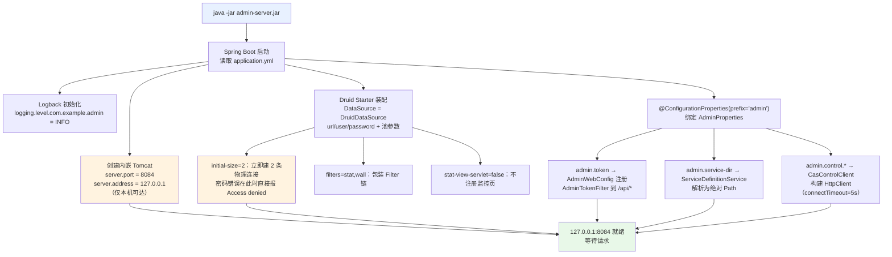
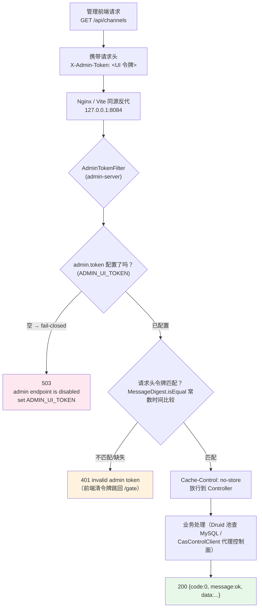
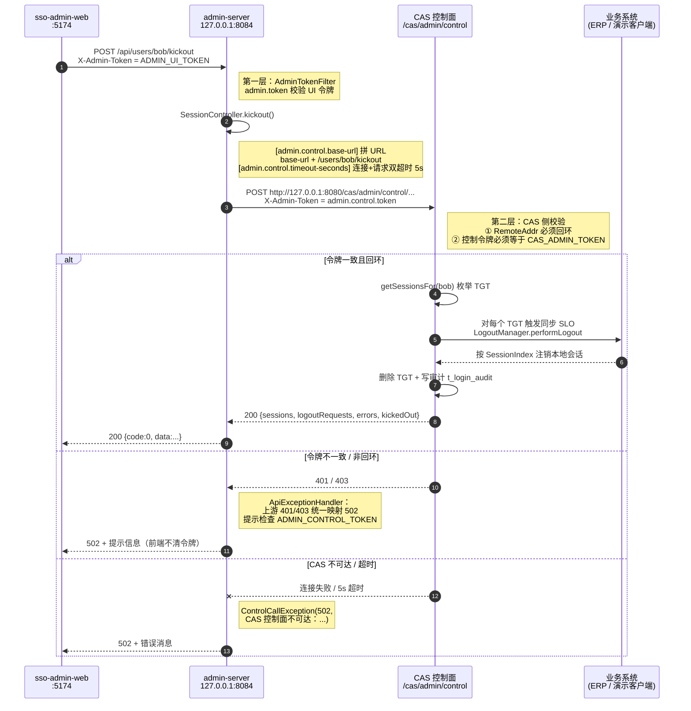
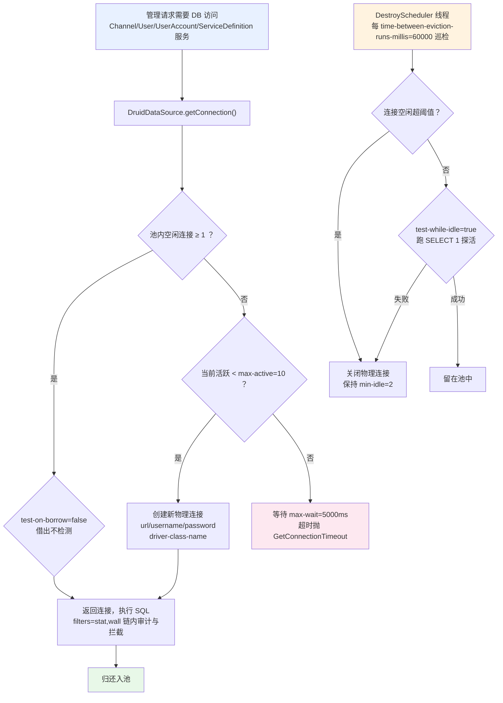

# application.yml 配置文件详解

> 对应文件：[src/main/resources/application.yml](src/main/resources/application.yml)
>
> admin-server 是 SSO 管理台的**数据面**服务（Spring Boot 3.3.2 + 内嵌 Tomcat + Druid + tk-mapper + MySQL），
> 承担条线/用户/授权/账号/服务定义的 CRUD，并以控制令牌代理同机 CAS 的控制面（会话、踢下线、服务卸载）。
> 本文逐条解析配置的含义、**代码中的使用位置**与**生效流程**，并给出启动、请求鉴权、
> 控制面代理、服务定义读写、连接池五张 mermaid 流程图。

## 目录

- [配置总览](#配置总览)
- [一、server.* — Web 容器](#一server--web-容器)
- [二、spring.application.name — 应用标识](#二springapplicationname--应用标识)
- [三、spring.datasource.* — Druid 连接池](#三springdatasource--druid-连接池)
- [四、admin.* — 管理台核心配置（自定义配置）](#四admin--管理台核心配置自定义配置)
- [五、logging.* — 日志级别](#五logging--日志级别)
- [六、环境变量覆盖总表](#六环境变量覆盖总表)
- [七、启动生效流程图](#七启动生效流程图)
- [八、请求鉴权流程图](#八请求鉴权流程图)
- [九、控制面代理流程图](#九控制面代理流程图)
- [十、服务定义读写流程图](#十服务定义读写流程图)
- [十一、Druid 连接池工作流程图](#十一druid-连接池工作流程图)
- [附：常见修改场景速查](#附常见修改场景速查)

---

## 配置总览

```yaml
server:        # 内嵌 Tomcat：端口 8084 + 仅绑定回环地址（安全边界的第一层）
spring:        # 应用名 + Druid 数据源（与 CAS/erp-server 同库 cas_sso）
admin:         # 自定义配置（AdminProperties 绑定）：UI 令牌、服务注册目录、CAS 控制面代理
logging:       # 项目包日志级别
```

四大块的生效方式不同：

| 块 | 绑定机制 | 生效时机 |
|---|---|---|
| `server.*` | Spring Boot `ServerProperties` 自动配置 | 容器启动前（创建 Tomcat 时） |
| `spring.datasource.*` | Druid starter `DruidDataSourceAutoConfigure` | 首次装配 DataSource Bean 时 |
| `admin.*` | `@ConfigurationProperties(prefix = "admin")` → [AdminProperties.java](src/main/java/com/example/admin/config/AdminProperties.java) | Bean 初始化时绑定，运行期只读 |
| `logging.level.*` | Logback 直接读取 | 日志系统初始化时，最早生效 |

与 erp-server 的关键差异：admin-server **没有 context-path**（API 直接挂在 `/api/**`），
**没有 HttpSession 配置**（无状态令牌鉴权，不用会话），多了 `server.address` 回环绑定与
双层令牌（`admin.token` 管入口、`admin.control.token` 管代理）。

---

## 一、server.* — Web 容器

### `server.port: 8084`

| 项 | 说明 |
|---|---|
| 含义 | 内嵌 Tomcat 的 HTTP 监听端口 |
| 端口规划 | 全套服务的端口分工：CAS 8080 / erp-server 8081 / admin-server **8084** / erp-web 5173 / sso-admin-web 5174 |
| 使用位置 | 无业务代码直接读取；由 `TomcatServletWebServerFactory` 创建 Connector 时消费 |
| 修改影响 | 管理前端 [sso-admin-web/vite.config.js](../sso-admin-web/vite.config.js) 的 `proxy '/api' → http://127.0.0.1:8084` 必须同步改 |

### `server.address: 127.0.0.1`

| 项 | 说明 |
|---|---|
| 含义 | **只监听回环地址**——本机以外的任何主机都无法连接 8084，即使防火墙放行 |
| 使用位置 | Tomcat Connector 绑定；端口检查可证实（仅 `127.0.0.1:8084` LISTEN，对比 CAS 的 `::` 全地址） |
| 安全定位 | 管理台安全模型的第一层：**网络隔离**。第二层是 [AdminTokenFilter](src/main/java/com/example/admin/web/AdminTokenFilter.java) 的令牌校验，第三层是控制面 CAS 侧的回环 + 令牌双重校验 |
| 部署约束 | 生产环境管理前端（sso-admin-web 的 dist）必须与 admin-server **同机部署**，由 Nginx 等反代在同源下转发 `/api`；跨机部署需要 SSH 隧道或改为绑定内网地址并加访问控制 |

---

## 二、spring.application.name — 应用标识

### `spring.application.name: admin-server`

| 项 | 说明 |
|---|---|
| 含义 | 应用名称标识 |
| 使用位置 | 日志 MDC 的 application 字段、Actuator `/info`、启动 banner；无注册中心场景主要是运维可读性 |
| 生效时机 | 启动 banner 与日志初始化阶段，早于大部分 Bean |

---

## 三、spring.datasource.* — Druid 连接池

> 本节与 erp-server 完全同构（同库 `cas_sso`、同 Druid 版本 1.2.28、同参数集），
> 差异仅在环境变量前缀（`ADMIN_DB_*`）。参数逐条解析见上文表格，此处说明数据面视角的特殊性。

### `spring.datasource.type: com.alibaba.druid.pool.DruidDataSource`

| 项 | 说明 |
|---|---|
| 含义 | 显式指定连接池实现为 Druid（而非默认 HikariCP） |
| 使用位置 | [pom.xml](pom.xml) 引入 `druid-spring-boot-3-starter:1.2.28`，自动配置读取后创建 `DruidDataSource` Bean |
| 数据面视角 | 管理台所有 CRUD（条线、用户、授权、账号、服务定义校验）都经此池；与 CAS 主进程**各自持有独立连接池**，互不影响 |

### `spring.datasource.druid.url`

```yaml
url: "${ADMIN_DB_URL:jdbc:mysql://localhost:3306/cas_sso?useSSL=false&allowPublicKeyRetrieval=true&serverTimezone=Asia/Shanghai&characterEncoding=UTF-8}"
```

| 项 | 说明 |
|---|---|
| 含义 | JDBC 连接串，`${环境变量:默认值}` 语法 |
| 参数逐个解析 | `localhost:3306` MySQL 地址；库 `cas_sso`（**与 CAS / erp-server 共库**，读写 `t_channel`/`t_user`/`t_user_channel`）；`useSSL=false` 本地明文；`allowPublicKeyRetrieval=true` MySQL 8 无 SSL 建连必需，否则 `Public Key Retrieval is not allowed`；`serverTimezone=Asia/Shanghai` 驱动时区，避免时间差 8 小时；`characterEncoding=UTF-8` 中文防乱码（Windows 下建库脚本还需 `--default-character-set=utf8mb4`） |
| 使用位置 | `DruidDataSource` 建连；`ChannelService` / `UserService` / `UserAccountService` / `ServiceDefinitionService`（校验 channelCode 存在）经 tk-mapper / JdbcTemplate 走此连接 |

### `spring.datasource.druid.username` / `password`

```yaml
username: "${ADMIN_DB_USER:root}"
password: "${ADMIN_DB_PASSWORD:}"
```

| 项 | 说明 |
|---|---|
| 含义 | 数据库账号/密码，环境变量 `ADMIN_DB_USER` / `ADMIN_DB_PASSWORD` 覆盖 |
| 默认值 | 用户名 `root`；**密码空**——本地 root 无密码才能裸跑 |
| 启动验证 | `initial-size: 2` 要求启动即建 2 条连接，**密码错误在启动阶段直接 `Access denied`**，不会拖到首次请求 |
| 权限建议 | 生产应为 admin-server 创建**只覆盖管理表**的最小权限账号（CAS 主进程与数据面分账号） |

### `spring.datasource.druid.driver-class-name: com.mysql.cj.jdbc.Driver`

| 项 | 说明 |
|---|---|
| 含义 | MySQL Connector/J 8.x 驱动类（`pom.xml` runtime 依赖） |
| 使用位置 | Druid 反射加载驱动后建连 |
| 备注 | 现代驱动可自动发现，显式声明是为版本绑定明确 |

### 池参数：`initial-size` / `min-idle` / `max-active` / `max-wait`

```yaml
initial-size: 2    # 启动即建 2 条物理连接（密码错启动期暴露）
min-idle: 2        # 保底空闲数，低于即补充
max-active: 10     # 池上限；超出者排队
max-wait: 5000     # 借连接最长等 5000ms，超时抛 GetConnectionTimeoutException
```

| 参数 | 使用位置 | 触发场景 |
|---|---|---|
| `initial-size` | Druid `init()` | 应用启动（DataSource 首次被引用） |
| `min-idle` | DestroyScheduler 巡检 | 空闲数不足时补建 |
| `max-active` | `getConnection()` | 并发借连接，池满排队 |
| `max-wait` | 同上 | 等待超 5 秒抛异常 → `ApiExceptionHandler` 兜底 500 |

管理台为低频内部系统，10 连接上限远超实际并发需求。

### 有效性检测：`validation-query` / `test-while-idle` / `test-on-borrow`

```yaml
validation-query: SELECT 1   # 探活 SQL
test-while-idle: true        # 空闲时检测（巡检线程执行）
test-on-borrow: false        # 借出前不检测（省往返，靠空闲检测兜底）
```

| 参数 | 使用位置 | 说明 |
|---|---|---|
| `validation-query` | Druid `testConnectionInternal` | `SELECT 1` 成功即视为连接可用 |
| `test-while-idle` | DestroyScheduler | 与 `test-on-borrow` 组合：牺牲少量实时性换吞吐 |
| `test-on-borrow` | 借出路径 | false = 借出不检测 |

### `spring.datasource.druid.time-between-eviction-runs-millis: 60000`

| 项 | 说明 |
|---|---|
| 含义 | 销毁/检测线程巡检周期：每 **60 秒**一次 |
| 使用位置 | Druid `DestroyScheduler` 定时任务 |
| 巡检动作 | 关闭空闲超 30 分钟（默认 `minEvictableIdleTimeMillis`）的连接并保持 `min-idle`；对存活连接跑 `SELECT 1` 探活 |
| 价值 | 清理 MySQL 侧已断开（`wait_timeout`、网络闪断）但池内残留的僵尸连接 |

### `spring.datasource.druid.filters: stat,wall`

| 项 | 说明 |
|---|---|
| 含义 | 启用 Druid Filter 链：`stat`（SQL 监控统计）+ `wall`（SQL 防火墙） |
| `stat` | 记录 SQL 执行次数/耗时/慢查询（数据在 JVM 内，未开可视化端点） |
| `wall` | 内置 SQL 注入防御：拦截无 where 的 delete、注释注入等危险语句 |
| 使用位置 | FilterChain 代理包裹连接，`prepareStatement/execute` 前后介入 |

### `spring.datasource.druid.stat-view-servlet.enabled: false`

| 项 | 说明 |
|---|---|
| 含义 | **关闭** Druid 自带 HTML 监控页（`/druid/index.html`） |
| 理由 | 监控页有独立弱口令风险；管理台本身已是高权限入口，不再叠加暴露面 |
| 使用位置 | `DruidStatViewServletConfiguration` 条件装配：false 不注册 Servlet |
| 若要开启 | 改 true 并**必须**配 `login-username`/`login-password`/`allow` IP 白名单 |

---

## 四、admin.* — 管理台核心配置（自定义配置）

> **绑定机制**：[AdminProperties.java](src/main/java/com/example/admin/config/AdminProperties.java)
> 标注 `@Component + @ConfigurationProperties(prefix = "admin")`，Spring Boot 初始化 Bean 时
> 松散绑定（relaxed binding）：`token → token`、`service-dir → serviceDir`、
> `control.base-url → control.baseBaseUrl`。默认值写在字段初始化，yml 值覆盖字段默认值。

### `admin.token: "${ADMIN_UI_TOKEN:}"`

| 项 | 说明 |
|---|---|
| 含义 | 管理前端的 UI 访问令牌，**为空时整个管理 API 关闭** |
| 使用位置 | [AdminWebConfig.java:19-26](src/main/java/com/example/admin/config/AdminWebConfig.java#L19-L26) 把它注入 `AdminTokenFilter` 构造器并注册到 `/api/*`；[AdminTokenFilter.java:32-43](src/main/java/com/example/admin/web/AdminTokenFilter.java#L32-L43) 执行校验 |
| 校验语义 | ① 令牌未配置（空）→ **503** `admin endpoint is disabled; set ADMIN_UI_TOKEN`（fail-closed，默认不可用而非无密码可用）；② 请求头 `X-Admin-Token` 缺失/不匹配 → **401** `invalid admin token`；③ 比较用 `MessageDigest.isEqual` **常数时间比较**，防时序侧信道逐字节猜令牌 |
| 消费方 | 管理前端 [sso-admin-web/src/api/index.js](../sso-admin-web/src/api/index.js) 每个请求自动携带 `X-Admin-Token`（令牌存 `sessionStorage`）；前端仅对 401 清令牌回登录页，503 直接展示后端错误 |
| 生产要求 | 必须设为足够长的随机串（如 `openssl rand -hex 32`） |

### `admin.service-dir: "${ADMIN_SERVICE_DIR:../etc/cas/services}"`

| 项 | 说明 |
|---|---|
| 含义 | 外置 CAS 服务注册表（JSON 文件）的目录，管理台直接读写这些文件 |
| 默认值 | `../etc/cas/services` —— **相对于 admin-server 的工作目录**。从 `admin-server/` 目录启动时指向仓库根的 `etc/cas/services/`（与 CAS `application.yml` 的 `sso.service-dir` 指向同一批文件） |
| 使用位置 | [ServiceDefinitionService.java:51](src/main/java/com/example/admin/service/ServiceDefinitionService.java#L51) 构造时 `Path.of(serviceDir).toAbsolutePath().normalize()` 一次解析；`list()` 扫描、`create()` 写入、`delete()` 删除都基于此 Path |
| 生效机制 | 新增/修改文件 → CAS 侧 JSON watcher **热加载**（无需重启）；**删除文件 watcher 不处理**，所以删除必须同时调 CAS 控制面 `ServicesManager.delete(id)` 卸载运行时服务（见 [十、服务定义读写流程图](#十服务定义读写流程图)） |
| 启动提示 | 若目录不存在，`list()` 返回空列表（不报错）；创建服务时目录不可写才暴露。**建议用 `ADMIN_SERVICE_DIR` 注入绝对路径**，避免不同启动目录导致相对路径漂移 |

### `admin.control.base-url`

```yaml
base-url: "${ADMIN_CONTROL_BASE:http://127.0.0.1:8080/cas/admin/control}"
```

| 项 | 说明 |
|---|---|
| 含义 | CAS 控制面（`/cas/admin/control/**`）的根地址 |
| 使用位置 | [CasControlClient.call():49](src/main/java/com/example/admin/client/CasControlClient.java#L49)：`base-url` 去尾斜杠后拼 `/users/{u}/sessions`、`/users/{u}/kickout`、`/services/{id}` 三个端点 |
| 为什么是 127.0.0.1 | CAS 控制面**只接受回环地址请求**（非回环 403）；admin-server 与 CAS 同机部署，直连本机恰好满足。若 CAS 前置了反向代理，此地址也**不能**改公网域名——否则 RemoteAddr 变成代理地址被拒 |
| 代理的三个接口 | GET sessions（在线 TGT 查询）/ POST kickout（强制踢下线）/ DELETE services（运行时卸载），见 [SessionController.java](src/main/java/com/example/admin/controller/SessionController.java) |

### `admin.control.token: "${ADMIN_CONTROL_TOKEN:}"`

| 项 | 说明 |
|---|---|
| 含义 | 调用 CAS 控制面所用的令牌，**必须与 CAS 侧 `CAS_ADMIN_TOKEN` 完全一致** |
| 使用位置 | [CasControlClient.call():52](src/main/java/com/example/admin/client/CasControlClient.java#L52)：每个代理请求加请求头 `X-Admin-Token: ${admin.control.token}` |
| 双层令牌模型 | `admin.token`（UI 令牌）：管理前端 → admin-server；`admin.control.token`（控制令牌）：admin-server → CAS 控制面。两层独立配置，控制令牌只在服务端出站请求中出现，浏览器不可见 |
| 配错现象 | CAS 侧校验失败返回 401/403 → [ApiExceptionHandler.java:30-45](src/main/java/com/example/admin/web/ApiExceptionHandler.java#L30-L45) 把上游 401/403 **统一映射为 502** 并提示"检查 ADMIN_CONTROL_TOKEN 与 CAS_ADMIN_TOKEN 是否一致"。这是刻意设计：若透传 401，前端会误以为 UI 令牌失效而清掉仍有效的令牌跳回登录页 |

### `admin.control.timeout-seconds: 5`

| 项 | 说明 |
|---|---|
| 含义 | 调用 CAS 控制面的超时秒数，**同时用作连接超时与每请求超时** |
| 使用位置 | [CasControlClient 构造器:30-33](src/main/java/com/example/admin/client/CasControlClient.java#L30-L33)（`HttpClient.connectTimeout`，Bean 创建时一次性生效）；[call():51](src/main/java/com/example/admin/client/CasControlClient.java#L51)（每个请求的 `timeout`） |
| 超时行为 | 连不上 → `ControlCallException(502, "CAS 控制面不可达：...")`；超时同样包装为 502 → 前端展示错误但**不清令牌、不跳转** |
| 权衡 | 踢下线是同步 SLO 回调（CAS 等 CRM 业务系统注销完成），网络差时可能较慢；5 秒是演示值，生产可适度放大 |

---

## 五、logging.* — 日志级别

### `logging.level.com.example.admin: INFO`

| 项 | 说明 |
|---|---|
| 含义 | `com.example.admin` 包及子包的日志门槛 INFO |
| 使用位置 | 各 Controller/Service 的 `LoggerFactory.getLogger(...)` |
| 典型日志 | 控制面调用失败 `Control plane call failed with status [...]`；管理 API 异常 `Admin API failure` + 堆栈 |
| 排障 | 临时改 `DEBUG` 看细节；未列出的包沿用 Spring Boot 默认（root INFO） |

---

## 六、环境变量覆盖总表

yml 中所有 `${VAR:default}` 的完整清单（`bin/env.cmd` 集中注入）：

| 环境变量 | 覆盖目标 | 默认值 | 说明 |
|---|---|---|---|
| `ADMIN_DB_URL` | `spring.datasource.druid.url` | `jdbc:mysql://localhost:3306/cas_sso?...` | 指向独立管理库时设置 |
| `ADMIN_DB_USER` | `spring.datasource.druid.username` | `root` | 生产改最小权限账号 |
| `ADMIN_DB_PASSWORD` | `spring.datasource.druid.password` | 空 | **有密码的 MySQL 必须设置**，否则启动失败 |
| `ADMIN_UI_TOKEN` | `admin.token` | 空 | 前端访问令牌；空 = 管理 API 整体 503 |
| `ADMIN_SERVICE_DIR` | `admin.service-dir` | `../etc/cas/services` | 建议注入绝对路径，避免相对路径漂移 |
| `ADMIN_CONTROL_BASE` | `admin.control.base-url` | `http://127.0.0.1:8080/cas/admin/control` | 仅 CAS 换端口/路径时改 |
| `ADMIN_CONTROL_TOKEN` | `admin.control.token` | 空 | **必须等于 CAS 侧 `CAS_ADMIN_TOKEN`** |

优先级：**环境变量 > application.yml 默认值**；`--admin.token=...` 命令行参数优先级更高。
三令牌关系图：

```
浏览器 ──(X-Admin-Token = ADMIN_UI_TOKEN)──▶ admin-server ──(X-Admin-Token = ADMIN_CONTROL_TOKEN ≡ CAS_ADMIN_TOKEN)──▶ CAS 控制面
```

---

## 七、启动生效流程图



要点：配置在**启动期一次性消费**，运行期改 yml 不生效（需重启）。
`ADMIN_UI_TOKEN` 未设置时服务仍能启动，但所有 `/api/**` 返回 503（fail-closed）。

---

## 八、请求鉴权流程图

`admin.token` 的完整消费链：



三类失败语义（前端按此区分处理）：

| 状态码 | 含义 | 前端行为 |
|---|---|---|
| 503 | `ADMIN_UI_TOKEN` 未配置，管理面整体关闭 | 入口页直接展示后端错误信息 |
| 401 | UI 令牌错误/缺失 | 清 `sessionStorage` 令牌，跳回 `/gate` |
| 502 | 控制面代理失败（鉴权不一致/不可达） | 只展示错误消息，**不清令牌、不跳转** |

---

## 九、控制面代理流程图

`admin.control.*` 三项配置的协同（以强制踢下线为例）：



三个代理端点共用同一链路：

| 端点 | HTTP | CAS 控制面路径 | 能力 |
|---|---|---|---|
| `GET /api/users/{u}/sessions` | GET | `/users/{u}/sessions` | 在线 TGT 与已接入服务 |
| `POST /api/users/{u}/kickout` | POST | `/users/{u}/kickout` | SLO + 删除全部 TGT |
| `DELETE /api/services/{id}` | DELETE | `/services/{id}` | 删除服务定义并卸载运行时 |

---

## 十、服务定义读写流程图

`admin.service-dir` 的消费全景（写文件 + 控制面卸载的混合模式）：

```mermaid
flowchart TD
    subgraph 新增服务
        A["POST /api/services<br/>(UI 令牌已过 AdminTokenFilter)"] --> B["ServiceDefinitionService.create()"]
        B --> C["校验：serviceId 正则锚定 / id 唯一 /<br/>channelCode 存在于 t_channel（走 Druid 池）"]
        C -- 不合法 --> D["400 参数错误"]
        C -- 合法 --> E["写 JSON 到 admin.service-dir/service-&lt;id&gt;.json"]
        E --> F["CAS watcher 监测到文件新增/修改<br/>热加载进运行时注册表（无需重启）"]
        F --> G["新服务立即可登录"]
    end

    subgraph 删除服务
        H["DELETE /api/services/{id}"] --> I["CasControlClient.deleteService(id)<br/>[admin.control.base-url + token]"]
        I --> J["CAS 控制面：删除 JSON 文件<br/>+ ServicesManager.delete(id) 运行时卸载"]
        J --> K["服务入口立即 403"]
    end

    subgraph 列表查询
        L["GET /api/services"] --> M["扫描 admin.service-dir 下<br/>service-数字.json 文件"]
        M --> N["解析 JSON + 关联 t_channel 名称<br/>返回列表"]
    end

    style D fill:#fde8f0
    style G fill:#e8f8e8
    style K fill:#e8f8e8
```



关键设计：**文件 watcher 只处理新增/修改，不处理删除**——所以删除走控制面
（文件删除 + `ServicesManager.delete` 运行时卸载两步一起做），手工直接删文件会导致
运行时残留，需重启 CAS 才能卸载。

---

## 十一、Druid 连接池工作流程图



---

## 附：常见修改场景速查

| 场景 | 需要改的配置 | 联动改动 |
|---|---|---|
| MySQL 有密码 | `ADMIN_DB_PASSWORD` 环境变量 | 无（或改默认值，但别提交真实密码） |
| 启用管理 API | `ADMIN_UI_TOKEN`（必设） | 同步给所有管理前端使用方 |
| 控制面调不通（502） | 检查 `ADMIN_CONTROL_TOKEN` 是否等于 CAS 的 `CAS_ADMIN_TOKEN` | 检查 CAS 是否在 8080 且 `ADMIN_CONTROL_BASE` 正确 |
| 服务定义读写失败/列表为空 | `ADMIN_SERVICE_DIR` 注入**绝对路径** | 确认目录与 CAS `sso.service-dir` 指向同一批文件 |
| admin-server 换端口 | `server.port` | ① 管理前端 `vite.config.js` 代理目标；② `bin` 脚本端口检查 |
| 跨机部署管理台 | 不可直接改 `server.address` 暴露公网 | 保持回环绑定，用 SSH 隧道 / 同机反代 / VPN 方案 |
| 生产 HTTPS 化 | 外层反代终止 TLS，admin-server 维持内网 HTTP | 反代将 `/api` 转发到 `127.0.0.1:8084`，并加访问白名单 |
| 排查管理接口问题 | `logging.level.com.example.admin: DEBUG` | 看 `Control plane call failed` / `Admin API failure` 定位 |
| 打开 SQL 监控页 | `stat-view-servlet.enabled: true` | **必须**配 `login-username`/`login-password`/`allow` 白名单 |

---

*文档基于 admin-server 1.0.0-SNAPSHOT（Spring Boot 3.3.2 / Druid 1.2.28 / CAS 7.3.8.3 联调环境）整理，生成于 2026-10-24。*
