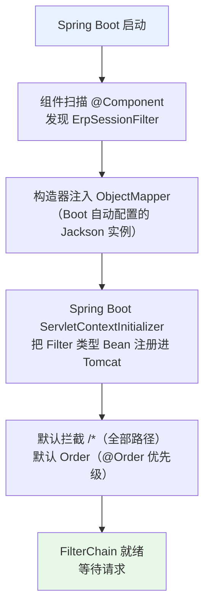
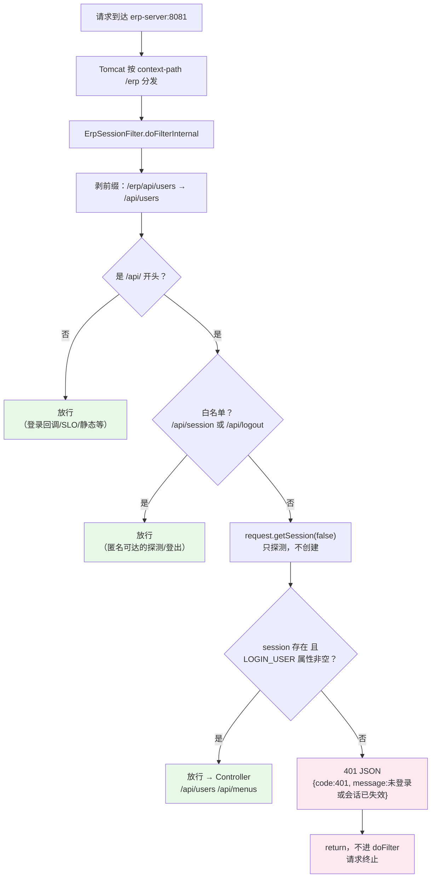
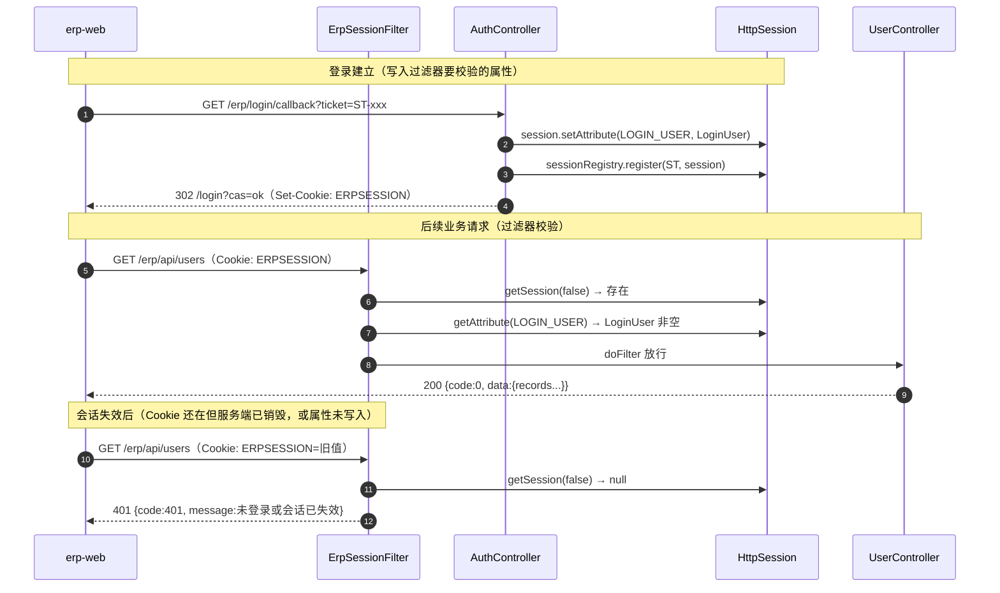
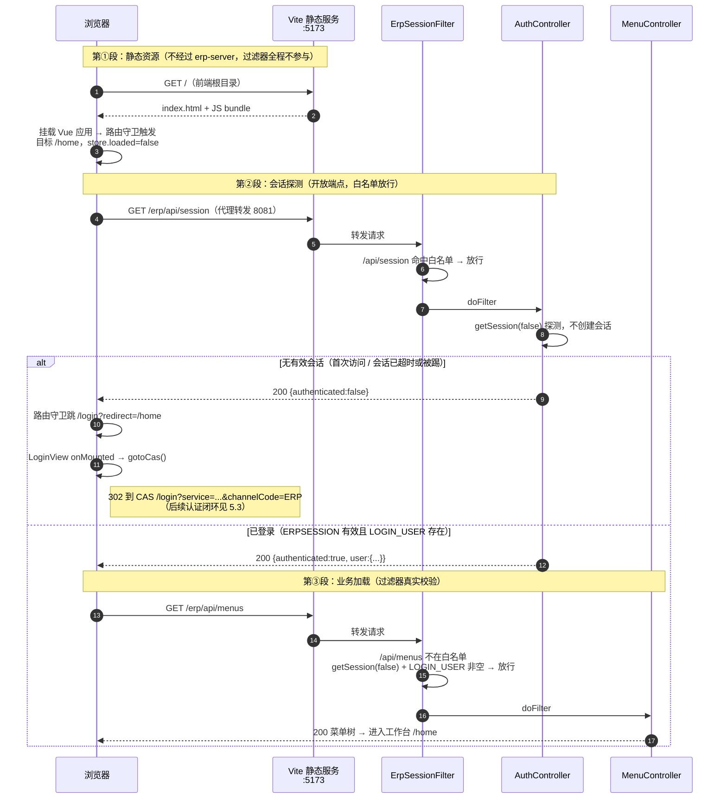
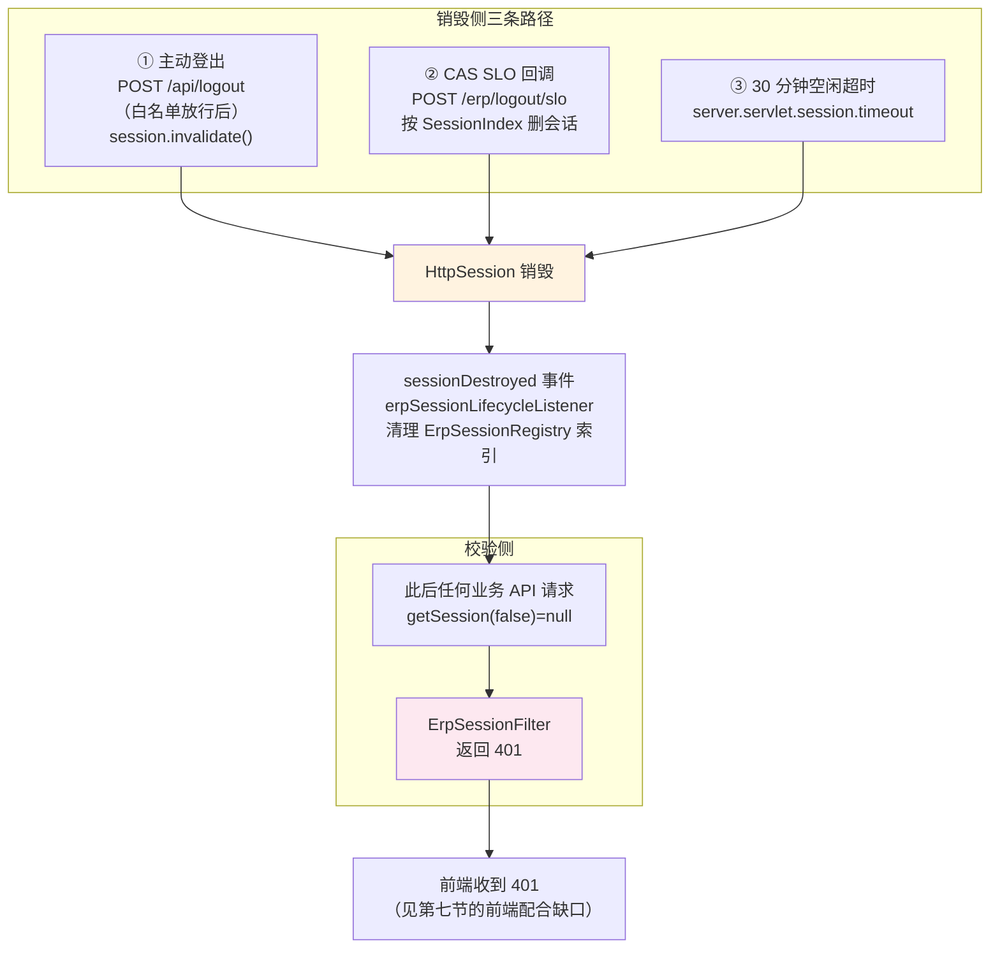

# ErpSessionFilter 解析：作用、代码详解与生效流程

> 对应源码：[src/main/java/com/example/erp/web/ErpSessionFilter.java](src/main/java/com/example/erp/web/ErpSessionFilter.java)（全文 43 行）
>
> erp-server 的 API 访问控制守门人——本文解析它解决什么问题、逐行拆解实现，
> 并用 mermaid 流程图展示它在请求链路中的位置、注册方式与全场景生效流程。

## 目录

- [一、它解决什么问题](#一它解决什么问题)
- [二、在整体架构中的位置](#二在整体架构中的位置)
- [三、完整代码](#三完整代码)
- [四、逐行代码解析](#四逐行代码解析)
- [五、生效流程图](#五生效流程图)（含 [5.4 问答：直接访问前端根目录的完整交互流程](#54-问答直接访问前端根目录httplocalhost5173-的完整交互流程)）
- [六、与其他会话失效机制的协作](#六与其他会话失效机制的协作)
- [七、设计取舍与已知边界](#七设计取舍与已知边界)
- [附：快速验证方法](#附快速验证方法)

---

## 一、它解决什么问题

erp-server 的 API 分两类：

| 类别 | 端点 | 是否需要登录 |
|---|---|---|
| **认证流程端点** | `/login/cas`、`/login/callback`、`/logout`、`/logout/slo` | 否（本身就是认证链路的一部分） |
| **开放查询端点** | `/api/session`、`/api/logout` | 否（前端靠它们探测登录态，必须匿名可访问） |
| **业务数据端点** | `/api/users`（[UserController](src/main/java/com/example/erp/controller/UserController.java)）、`/api/menus`（[MenuController](src/main/java/com/example/erp/controller/MenuController.java)） | **是** |

`ErpSessionFilter` 的职责就一句话：**让第三类端点在没有有效 ERP 会话时返回统一的 401 JSON，而不是放行或抛 HTML 错误页**。

没有它会发生什么：

- `/api/users`、`/api/menus` 裸奔，任何人可拖走全量用户数据和菜单树；
- `MenuController.menus()` 里 `request.getSession()`（无参，**会自动创建会话**）给匿名请求凭空发 Cookie；
- 未登录调用返回的错误格式与前端 `ApiResult` 解析约定不一致，前端无法统一处理。

## 二、在整体架构中的位置

```text
浏览器 ── Cookie: ERPSESSION=xxx
   │
   ▼
Vite 代理 /erp → 8081（开发态）
   │
   ▼
Tomcat（context-path=/erp）
   │
   ▼
FilterChain ──▶ ① ErpSessionFilter   ← 本文：会话门卫，只拦 /api/**
   │
   ▼
DispatcherServlet ──▶ ② Controller ──▶ ③ Service ──▶ ④ Druid 池 ──▶ MySQL
```

它在** Filter 层**（请求进入 Spring MVC 之前）完成拦截，被拒的请求根本到不了 Controller，
这是"横切关注点"（cross-cutting concern）的标准落点——业务代码零侵入。

## 三、完整代码

```java
package com.example.erp.web;

import com.example.erp.common.ApiResult;
import com.example.erp.common.SessionKeys;
import com.fasterxml.jackson.databind.ObjectMapper;
import jakarta.servlet.FilterChain;
import jakarta.servlet.ServletException;
import jakarta.servlet.http.HttpServletRequest;
import jakarta.servlet.http.HttpServletResponse;
import lombok.RequiredArgsConstructor;
import org.springframework.stereotype.Component;
import org.springframework.web.filter.OncePerRequestFilter;

import java.io.IOException;

/**
 * 保护 /api/**：除会话查询和登出外，必须已建立 ERP 会话。
 */
@Component
@RequiredArgsConstructor
public class ErpSessionFilter extends OncePerRequestFilter {

    private final ObjectMapper objectMapper;

    @Override
    protected void doFilterInternal(final HttpServletRequest request,
                                    final HttpServletResponse response,
                                    final FilterChain filterChain)
            throws ServletException, IOException {
        final String path = request.getRequestURI().substring(request.getContextPath().length());
        if (path.startsWith("/api/") && !"/api/session".equals(path) && !"/api/logout".equals(path)) {
            final var session = request.getSession(false);
            if (session == null || session.getAttribute(SessionKeys.LOGIN_USER) == null) {
                response.setStatus(HttpServletResponse.SC_UNAUTHORIZED);
                response.setContentType("application/json;charset=UTF-8");
                objectMapper.writeValue(response.getWriter(),
                        ApiResult.fail(401, "未登录或会话已失效"));
                return;
            }
        }
        filterChain.doFilter(request, response);
    }
}
```

## 四、逐行代码解析

### 类声明与注解（19-21 行）

```java
@Component
@RequiredArgsConstructor
public class ErpSessionFilter extends OncePerRequestFilter {
```

| 元素 | 解析 |
|---|---|
| `@Component` | 让 Spring 扫描注册。**关键机制**：`OncePerRequestFilter` 类上有 `@Order(0)` 元数据且实现了Filter 接口，Spring Boot 会自动把所有 Filter 类型的 Bean 注册进 Servlet 容器的 FilterChain——不需要手写 `FilterRegistrationBean`（对比 admin-server 的 `AdminTokenFilter` 是 new 出来的普通类，必须手动注册并指定 `/api/*` 与顺序） |
| `@RequiredArgsConstructor` | Lombok 为 `final` 字段生成构造器，实现**构造器注入**（不可变、利于测试） |
| `extends OncePerRequestFilter` | Spring 提供的抽象基类，**保证单个请求只过滤一次**。为什么需要：Servlet 规范允许同一 Filter 在 forward/include 派发时被执行多次；异步 Servlet（`AsyncContext`）也可能重复进入。直接实现 `Filter` 接口则要自己防重 |
| 放在 `web` 包 | 项目分层约定：`web` 放 HTTP 侧构件（过滤器/异常处理器），`controller` 放端点 |

### 依赖注入（23 行）

```java
private final ObjectMapper objectMapper;
```

复用 Spring Boot 自动配置的 Jackson `ObjectMapper`（就是 Controller 序列化响应用的同一个实例），
保证 401 响应体的 JSON 结构（字段名、null 处理）与业务接口完全一致。

### 路径解析（30 行）

```java
final String path = request.getRequestURI().substring(request.getContextPath().length());
```

| 点 | 解析 |
|---|---|
| `getRequestURI()` | 返回**含 context-path** 的原始路径，如 `/erp/api/users` |
| `getContextPath()` | 即 `server.servlet.context-path: /erp`（见 [application.yml:4](src/main/resources/application.yml#L4)） |
| 整行效果 | 剥掉前缀得到**应用内路径** `/api/users`——后面的白名单匹配才与部署前缀无关 |

为什么不写在 yml 里配置？路径规则是代码逻辑的一部分（与 Controller 的 `@GetMapping` 映射强耦合），硬编码更直观，改路由时同文件可见。

### 保护规则：一条 if 表达三个条件（31 行）

```java
if (path.startsWith("/api/") && !"/api/session".equals(path) && !"/api/logout".equals(path)) {
```

| 条件 | 意图 | 精确匹配（equals）而非前缀的原因 |
|---|---|---|
| `path.startsWith("/api/")` | 只保护业务 API | 登录回调 `/login/callback`、SLO 回调 `/logout/slo` 不在 `/api/` 下，天然放行（SLO 是 CAS 服务端到服务端调用，必须匿名可达） |
| `!"/api/session".equals(path)` | 白名单：会话探测 | 前端路由守卫靠它判断登录态（[AuthController.session():85-93](src/main/java/com/example/erp/controller/AuthController.java#L85-L93)），**未登录也返回 200 + `authenticated=false`** 而非 401，避免前端把"探测"误当"鉴权失败" |
| `!"/api/logout".equals(path)` | 白名单：登出 | 未登录状态也允许调登出（幂等清理），且登出响应里要带 `casLogoutUrl` 让浏览器跳 CAS |

注意 `/api/session` 用的是 `equals` 精确匹配——`/api/session/xxx` **不在白名单**，会被拦（符合预期：没有这个端点）。

### 会话校验（32-33 行）

```java
final var session = request.getSession(false);
if (session == null || session.getAttribute(SessionKeys.LOGIN_USER) == null) {
```

| 点 | 解析 |
|---|---|
| `getSession(false)` | **核心参数**：只在会话已存在时返回，否则返回 null。对比 `MenuController:23` 的 `getSession()`（无参=true）会**为匿名请求创建空会话**——那正是过滤器要挡在前面避免的副作用。这里用 false 保证"探测不产生副作用" |
| `session == null` | 覆盖三种情况：① 浏览器没带 Cookie（首次访问/已失效）；② Cookie 对应的会话已被销毁（登出/SLO/超时）；③ Cookie 是伪造的随机串 |
| `getAttribute(LOGIN_USER) == null` | 双保险：会话存在但**未登录**。覆盖"会话被创建了但没走完登录流程"的窗口——例如匿名请求曾触达某个用 `getSession()` 的代码路径，拿到了合法会话 ID，但里面没有登录用户 |
| `SessionKeys.LOGIN_USER` | 常量 `"ERP_LOGIN_USER"`（[SessionKeys.java:8](src/main/java/com/example/erp/common/SessionKeys.java#L8)）。写入方是登录回调 [AuthController.loginCallback():79](src/main/java/com/example/erp/controller/AuthController.java#L79)：`session.setAttribute(SessionKeys.LOGIN_USER, loginUser)`。常量类避免字符串散落导致读写键不一致 |
| 判空顺序 | `||` 短路：session 为 null 时不会执行第二个条件（否则 NPE） |

### 拒绝响应（34-38 行）

```java
response.setStatus(HttpServletResponse.SC_UNAUTHORIZED);        // 401
response.setContentType("application/json;charset=UTF-8");
objectMapper.writeValue(response.getWriter(),
        ApiResult.fail(401, "未登录或会话已失效"));
return;
```

| 点 | 解析 |
|---|---|
| `setStatus(401)` | HTTP 标准状态码 Unauthorized。浏览器/axios 都能识别；对比 403（Forbidden，语义是"已认证但无权限"）——这里是"没有身份"，用 401 更准确 |
| `setContentType` | 显式声明 UTF-8，中文消息不乱码 |
| `ApiResult.fail(401, ...)` | 统一响应结构 `{code, message, data}`（[ApiResult.java:12-14](src/main/java/com/example/erp/common/ApiResult.java#L12-L14)），与业务接口的成功响应 `{code:0, message:"ok", data:...}` 同构。**为什么不用 `@RestControllerAdvice`**：异常处理器只能捕获进入 MVC 之后抛出的异常，Filter 在 DispatcherServlet 之前，advice 够不着，所以必须手写响应 |
| `writeValue(response.getWriter(), ...)` | Jackson 序列化到响应流 |
| `return` | **不再调用 `filterChain.doFilter`**——请求到此终止，不进入 DispatcherServlet。这是 Filter 拦截的标志：不续链 = 请求被吞掉 |

### 放行（41 行）

```java
filterChain.doFilter(request, response);
```

白名单路径、非 `/api/` 路径、已登录请求都走到这里——把请求交给链上的下一个 Filter，
最终到达 DispatcherServlet → Controller。

## 五、生效流程图

### 5.1 注册流程（启动期）



**注册方式对比**（本项目两种都用了）：

| 方式 | 项目里的例子 | 拦截路径 | 顺序 |
|---|---|---|---|
| `@Component` 自动注册 | **ErpSessionFilter**（本文） | `/*`（全路径，靠代码内 if 判断） | Filter Bean 默认顺序 |
| 手动 `FilterRegistrationBean` | admin-server 的 `AdminTokenFilter`（[AdminWebConfig:19-26](../admin-server/src/main/java/com/example/admin/config/AdminWebConfig.java#L19-L26)）；CAS 侧的 `ChannelCodeValidationFilter` | `/api/*` 精确指定 | 显式 `setOrder(MIN+1001)` |

### 5.2 请求处理流程（运行期，四种场景）



### 5.3 登录态的建立与校验闭环（时序图）

过滤器校验的 `LOGIN_USER` 属性从哪来、到哪去：



### 5.4 问答：直接访问前端根目录（http://localhost:5173/）的完整交互流程

**问**：`/api/session` 是开放端点，那用户直接在浏览器输入前端根目录地址时，整条链路是怎么走的？`ErpSessionFilter` 在哪一步参与？

**答**：整个交互分**三段**——静态资源段根本不经过 erp-server；会话探测段走开放端点白名单；业务加载段才接受过滤器的真实校验。按"是否已登录"走出两个分支：

| 段 | 参与方 | ErpSessionFilter |
|---|---|---|
| ① 静态资源 | 浏览器 ↔ Vite(5173) | **不参与**（erp-server 不经手） |
| ② 会话探测 | 浏览器 → Vite 代理 → `/api/session` | 白名单放行（等于"在场但放行"） |
| ③ 业务加载 | 浏览器 → Vite 代理 → `/api/menus` 等 | 真实校验（本节主角） |



**三个关键认知**：

1. **页面壳公开，数据边界在 API。** 前端根目录返回的 HTML/JS 由 Vite（开发态）或 Nginx（发布态）直接提供，`ErpSessionFilter` 管不到它们——SPA 架构里页面壳永远公开，真正需要保护的是数据接口。这正是第一节"只保护 `/api/**`"的架构依据：拦截 HTML 没有意义，拦住 `getSession(false)` 拿不到 `LOGIN_USER` 的数据请求才是安全边界。
2. **开放端点的价值：让前端能"区分两种未登录"。** 如果 `/api/session` 也被 401 拦截，前端收到的只有"失败"，无法区分"还没登录过"（该跳 CAS）与"会话刚过期"（提示后跳 CAS）。作为开放端点，它永远返回 200 + `authenticated` 布尔值，把判断权交给路由守卫——这就是白名单里 `equals` 精确匹配（第四节）放行它的原因。
3. **探测无副作用。** `AuthController.session()` 用 `getSession(false)`（第四节"会话校验"同款手法）：匿名访客探测一次**不会**被种下 ERPSESSION Cookie，不会制造"有会话但未登录"的中间态，也避免了无谓的服务端会话内存分配。未登录访客无论刷新多少次首页，服务端零会话产生。

## 六、与其他会话失效机制的协作

`ErpSessionFilter` 是**校验侧**；会话的**销毁侧**有三条路径，销毁后过滤器自然拦截（它只读会话状态，不负责销毁）：



三路径细节：

1. **主动登出**：[AuthController.logout():95-99](src/main/java/com/example/erp/controller/AuthController.java#L95-L99)——注意 `/api/logout` 在过滤器白名单里，未登录也能调（幂等）。
2. **SLO 回调**：CAS 注销 TGT 或管理台踢下线时 POST `/erp/logout/slo`，[ErpSessionRegistry.invalidateBySessionIndex():29-41](src/main/java/com/example/erp/service/ErpSessionRegistry.java#L29-L41) 按 ST（即 SessionIndex）找到会话并 `invalidate()`。此端点不在 `/api/` 下，过滤器天然放行。
3. **超时**：Tomcat 空闲 30 分钟后销毁，listener 清索引，孤儿条目不残留。

## 七、设计取舍与已知边界

| # | 取舍/边界 | 说明 |
|---|---|---|
| 1 | **白名单硬编码在代码里** | 加一个新的匿名端点必须改此文件重编译。换取的是规则与路由定义同文件可见、无配置漂移。端点少时合理 |
| 2 | **放行非 `/api/` 的一切路径** | `/login/*`、`/logout/slo` 必须匿名可达（认证链路本身），所以"保护名单制"（只拦 api）比"拦截名单制"（逐个排除）更安全——新增 Controller 忘记加保护时默认放行的是**页面路由**而非数据接口；但若未来有人在 `/api/` 外新开数据端点就会漏保护，需约定"业务数据一律挂 /api/" |
| 3 | **单节点内存会话** | 过滤器校验的是本机 Tomcat 的 StandardManager 会话；多节点部署时需换 Spring Session（Redis 等）共享，过滤器代码**不用改**（它只调 Servlet API，与存储实现解耦）——这是用标准 `HttpSession` API 的好处 |
| 4 | **只校验登录，不校验权限** | 通过 = 任何已登录用户都能查全部用户/菜单。条线级数据隔离在 [MenuController:25](src/main/java/com/example/erp/controller/MenuController.java#L25) 按 `user.channelCode()` 过滤实现（菜单按条线下发），更细粒度授权属业务层职责 |
| 5 | **前端 401 处理**（已补齐，2026-10-24） | erp-web 的 axios 拦截器（[api/index.js:14-21](../erp-web/src/api/index.js#L14-L21)）现已对 401 整页跳 `/login?redirect=当前路径`：深链接经 sessionStorage 暂存，CAS 回调 `cas=ok` 后由 `targetPath()` 还原；跳转用 `location.assign`（api 模块被 router→stores 依赖，反向引 router 会成环，且整页跳转顺带重置 Pinia 的 `loaded` 状态）。与 sso-admin-web 的 [401 处理](../sso-admin-web/src/api/index.js#L45-L50)（清令牌跳 `/gate`）对齐 |
| 6 | **INFO 级无日志** | 被拒请求不打访问日志（仅容器 access log），高频扫描时不易察觉。可按需在 401 分支加 `LOGGER.debug` |

## 附：快速验证方法

```bash
# 1. 未登录直接调业务 API → 401 JSON
curl -i http://localhost:8081/erp/api/users
# HTTP/1.1 401，{"code":401,"message":"未登录或会话已失效","data":null}

# 2. 白名单端点未登录也可达 → 200
curl -i http://localhost:8081/erp/api/session
# HTTP/1.1 200，{"code":0,...,"data":{"authenticated":false,...}}

# 3. 登录后带 Cookie 调用 → 200
#    （浏览器完成 CAS 登录后复制 ERPSESSION Cookie）
curl -i -H "Cookie: ERPSESSION=<你的会话ID>" http://localhost:8081/erp/api/users
# HTTP/1.1 200，{"code":0,...,"data":{"records":[...]}}

# 4. 登出后再用旧 Cookie → 回到 401
curl -i -H "Cookie: ERPSESSION=<旧会话ID>" http://localhost:8081/erp/api/users
# HTTP/1.1 401
```

---

*文档基于 erp-server 1.0.0-SNAPSHOT 源码整理，生成于 2026-10-24。*
