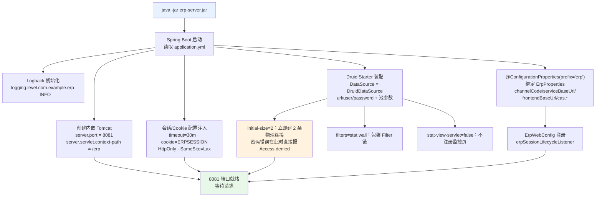
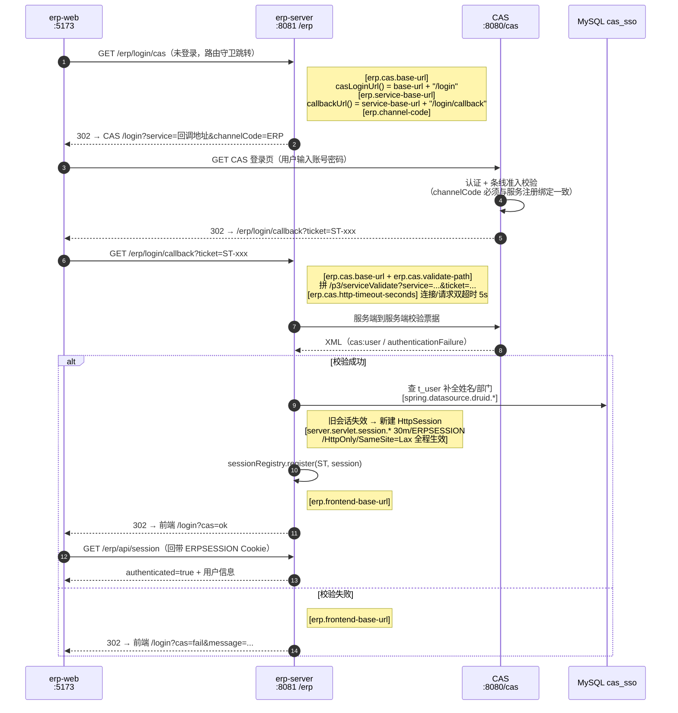
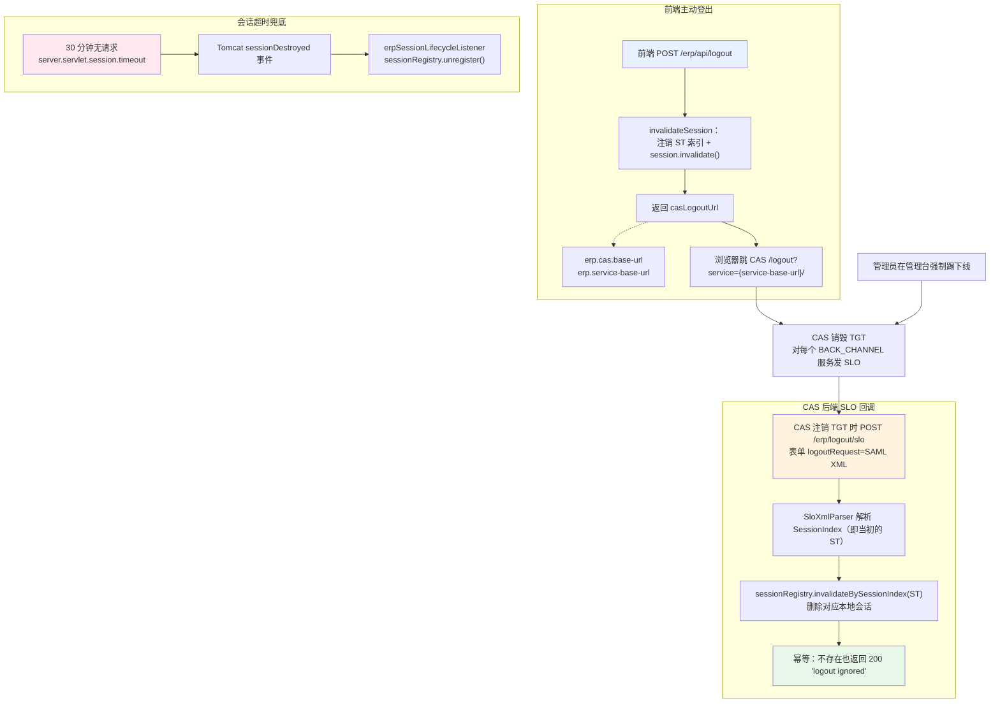
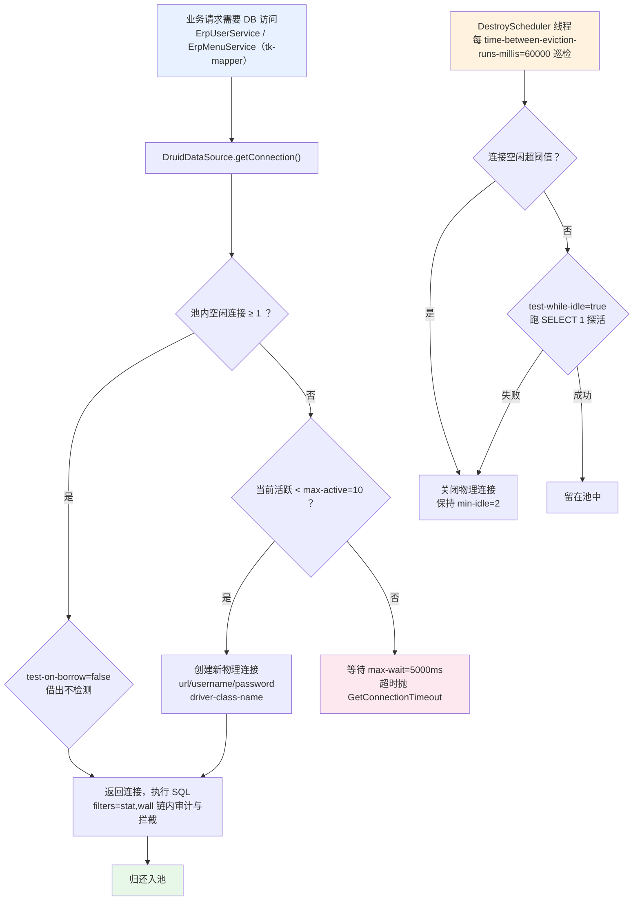

# application.yml 配置文件详解

> 对应文件：[src/main/resources/application.yml](src/main/resources/application.yml)
>
> erp-server 是 ERP 演示系统的后端（Spring Boot 3.3.2 + 内嵌 Tomcat + Druid + tk-mapper + MySQL），
> 以 `channelCode=ERP` 接入 CAS 单点登录。本文逐条解析配置的含义、**代码中的使用位置**与**生效流程**，
> 并给出启动、登录、登出/SLO、连接池四张 mermaid 流程图。

## 目录

- [配置总览](#配置总览)
- [一、server.* — Web 容器与会话](#一server--web-容器与会话)
- [二、spring.application.name — 应用标识](#二springapplicationname--应用标识)
- [三、spring.datasource.* — Druid 连接池](#三springdatasource--druid-连接池)
- [四、erp.* — 业务与 CAS 集成（自定义配置）](#四erp--业务与-cas-集成自定义配置)
- [五、logging.* — 日志级别](#五logging--日志级别)
- [六、环境变量覆盖总表](#六环境变量覆盖总表)
- [七、启动生效流程图](#七启动生效流程图)
- [八、CAS 登录流程图（配置消费点）](#八cas-登录流程图配置消费点)
- [九、登出与 SLO 流程图](#九登出与-slo-流程图)
- [十、Druid 连接池工作流程图](#十druid-连接池工作流程图)
- [附：常见修改场景速查](#附常见修改场景速查)

---

## 配置总览

```yaml
server:        # 内嵌 Tomcat：端口、 context-path、HttpSession 与 Cookie 策略
spring:        # 应用名 + Druid 数据源（连接池参数、过滤器和监控开关）
erp:           # 自定义业务配置（ErpProperties 绑定）：条线、回调、前端地址、CAS 集成
logging:       # 项目包日志级别
```

四大块的生效方式不同：

| 块 | 绑定机制 | 生效时机 |
|---|---|---|
| `server.*` | Spring Boot `ServerProperties` 自动配置 | 容器启动前（创建 Tomcat 时） |
| `spring.datasource.*` | Druid starter `DruidDataSourceAutoConfigure` | 首次装配 DataSource Bean 时 |
| `erp.*` | `@ConfigurationProperties(prefix = "erp")` → [ErpProperties.java](src/main/java/com/example/erp/config/ErpProperties.java) | Bean 初始化时绑定，运行期只读 |
| `logging.level.*` | Logback 直接读取 | 日志系统初始化时，最早生效 |

---

## 一、server.* — Web 容器与会话

### `server.port: 8081`

| 项 | 说明 |
|---|---|
| 含义 | 内嵌 Tomcat 的 HTTP 监听端口 |
| 默认值 | Spring Boot 默认 8080；此处显式改为 **8081**，避开 CAS（8080） |
| 使用位置 | 无业务代码直接读取；由 `TomcatServletWebServerFactory` 在创建连接器（Connector）时消费 |
| 修改影响 | 所有对 erp-server 的访问（浏览器、erp-web 的 Vite 代理、CAS 的 SLO 回调）都必须同步改端口 |

关联配置：[erp-web/vite.config.js](../erp-web/vite.config.js) 的 `proxy '/erp' → http://localhost:8081`、
CAS 服务注册 [../etc/cas/services/service-3001.json](../etc/cas/services/service-3001.json) 的
`serviceId = ^http://localhost:8081/erp/.*$`。**改端口必须三处同步**，否则登录回调 403（未注册服务）或前端代理失败。

### `server.servlet.context-path: /erp`

| 项 | 说明 |
|---|---|
| 含义 | 应用的 URL 根前缀。所有 Controller 映射都叠加 `/erp` 前缀 |
| 使用位置 | Tomcat 按 context-path 分发请求；[ErpSessionFilter.java:30](src/main/java/com/example/erp/web/ErpSessionFilter.java#L30) 中 `request.getRequestURI().substring(request.getContextPath().length())` 显式剥掉它再做路径判断 |
| 生效示例 | `AuthController` 的 `@GetMapping("/login/cas")` 实际完整路径为 `http://localhost:8081/erp/login/cas` |

这也是 CAS 服务注册表锚定 `^http://localhost:8081/erp/.*$` 的原因——`serviceId` 正则匹配的是**含 context-path 的完整 URL**。

### `server.servlet.session.timeout: 30m`

| 项 | 说明 |
|---|---|
| 含义 | HttpSession 的最大空闲时长。**30 分钟无请求**后会话过期销毁 |
| 使用位置 | Tomcat 会话管理器；过期时触发 `HttpSessionEvent`，被 [ErpWebConfig.java:13-19](src/main/java/com/example/erp/config/ErpWebConfig.java#L13-L19) 注册的 `erpSessionLifecycleListener` 捕获，调用 `sessionRegistry.unregister(session)` 清理 ST → session 索引 |
| 生效流程 | 请求进入 → 刷新会话 lastAccessedTime → 后台过期检查 → `sessionDestroyed()` → 注销索引 |

格式为 Duration 风格：`30m` = 30 分钟（也可写 `1800s`、`PT30M`）。
该超时是 ERP 本地会话的**兜底失效机制**；正常登出靠用户主动 / SLO 回调，会话超时兜住"浏览器直接关闭"的场景。

### `server.servlet.session.cookie.name: ERPSESSION`

| 项 | 说明 |
|---|---|
| 含义 | 会话 Cookie 的名字。默认是 `JSESSIONID`，改成 `ERPSESSION` |
| 使用位置 | Tomcat 在 `Set-Cookie` 响应头写入；后续请求浏览器自动回带 |
| 修改影响 | 前端无需感知（HttpOnly，JS 本来就读不到）；改名主要是与同域部署的其他系统（CAS 的 `TGC`、演示客户端）区分，避免混用 |

### `server.servlet.session.cookie.http-only: true`

| 项 | 说明 |
|---|---|
| 含义 | Cookie 附加 `HttpOnly` 标志，**JavaScript 无法通过 `document.cookie` 读取** |
| 使用位置 | `Set-Cookie: ERPSESSION=...; HttpOnly` 响应头 |
| 安全意义 | 即使页面被注入恶意脚本（XSS），也无法偷走会话 ID。浏览器只会在 HTTP 请求中自动携带 |

### `server.servlet.session.cookie.same-site: lax`

| 项 | 说明 |
|---|---|
| 含义 | SameSite 策略为 `Lax`：**顶级导航的 GET 跳转会携带 Cookie**，跨站 POST/iframe 不携带 |
| 使用位置 | `Set-Cookie: ...; SameSite=Lax` 响应头 |
| 为什么是 lax | CAS 登录成功后是 `302 Location: http://localhost:5173/login?cas=ok` 的**顶级 GET 跳转**，`Lax` 恰好允许 Cookie 跟随；若用 `Strict`，从 CAS 域跳回 8081 时会话 Cookie 会被丢弃，回调就"失忆"了 |

---

## 二、spring.application.name — 应用标识

### `spring.application.name: erp-server`

| 项 | 说明 |
|---|---|
| 含义 | 应用名称标识 |
| 使用位置 | 日志 MDC 的 application 字段、Actuator `/info`、服务注册（本项目未用注册中心，主要是日志与运维可读性） |
| 生效时机 | 启动 banner 与日志初始化阶段，早于大部分 Bean |

---

## 三、spring.datasource.* — Druid 连接池

### `spring.datasource.type: com.alibaba.druid.pool.DruidDataSource`

| 项 | 说明 |
|---|---|
| 含义 | 显式指定连接池实现为 Alibaba Druid（而非 Spring Boot 默认的 HikariCP） |
| 使用位置 | [druid-spring-boot-3-starter](pom.xml#L36-L39)（`pom.xml` 引入 `druid-spring-boot-3-starter:1.2.28`）的自动配置类读取后创建 `DruidDataSource` Bean |
| 生效流程 | 见 [十、Druid 连接池工作流程图](#十druid-连接池工作流程图) |

> 依赖来源：`pom.xml` 中 `com.alibaba:druid-spring-boot-3-starter`。若移除该依赖而不改 type，启动会 ClassNotFound。

### `spring.datasource.druid.url`

```yaml
url: "${ERP_DB_URL:jdbc:mysql://localhost:3306/cas_sso?useSSL=false&allowPublicKeyRetrieval=true&serverTimezone=Asia/Shanghai&characterEncoding=UTF-8}"
```

| 项 | 说明 |
|---|---|
| 含义 | JDBC 连接串。语法 `${环境变量:默认值}` —— 有 `ERP_DB_URL` 环境变量用变量，否则用冒号后的默认值 |
| 参数逐个解析 | `localhost:3306` MySQL 地址；库名 `cas_sso`（**与 CAS 共库**，读 `t_user`/`erp_menu`）；`useSSL=false` 本地明文连接；`allowPublicKeyRetrieval=true` 允许客户端向服务器请求公钥（MySQL 8 + 无 SSL 时必需，否则 `Public Key Retrieval is not allowed`）；`serverTimezone=Asia/Shanghai` 驱动侧时区，避免时间字段差 8 小时；`characterEncoding=UTF-8` 连接字符集，防中文乱码 |
| 使用位置 | `DruidDataSource` 建连时使用；`ErpUserService` / `ErpMenuService` 经 tk-mapper 走此连接 |
| 生产建议 | 走环境变量注入，改最小权限账号，开启 `useSSL` |

### `spring.datasource.druid.username` / `spring.datasource.druid.password`

```yaml
username: "${ERP_DB_USER:root}"
password: "${ERP_DB_PASSWORD:}"
```

| 项 | 说明 |
|---|---|
| 含义 | 数据库账号/密码，同样支持环境变量覆盖 |
| 默认值 | 用户名默认 `root`；**密码默认空**——本地 MySQL root 无密码才能裸跑，否则必须 `set ERP_DB_PASSWORD=...` |
| 使用位置 | `DruidDataSource.getConnection()` 建立物理连接时 |
| 启动验证 | 连接池 `initial-size: 2` 要求启动时初始化 2 条连接，**密码错误会在启动阶段直接报 `Access denied` 而非拖到首次请求** |

### `spring.datasource.druid.driver-class-name: com.mysql.cj.jdbc.Driver`

| 项 | 说明 |
|---|---|
| 含义 | JDBC 驱动类（MySQL Connector/J 8.x，`pom.xml` runtime 依赖） |
| 使用位置 | Druid 反射加载驱动类后建连；DriverManager 注册 |
| 备注 | 现代驱动可自动发现，显式声明是为了明确与 `mysql-connector-j` 版本绑定 |

### 池参数：`initial-size` / `min-idle` / `max-active` / `max-wait`

```yaml
initial-size: 2    # 物理初始化连接数：启动即创建，密码错会在启动期暴露
min-idle: 2        # 池内保底空闲连接数，低于此值触发补充
max-active: 10     # 池内最大活跃连接上限；超出者排队等待
max-wait: 5000     # 借连接最长等待 5000ms，超时抛 GetConnectionTimeoutException
```

| 参数 | 使用位置 | 触发场景 |
|---|---|---|
| `initial-size` | Druid `init()` | 应用启动（DataSource 首次被引用） |
| `min-idle` | DestroyScheduler 空闲检查线程 | 空闲连接数 < min-idle 时创建补充 |
| `max-active` | `GetConnection` 逻辑 | 并发请求借连接，池满则等待 |
| `max-wait` | 同上 | 等待超过 5 秒抛异常，请求失败返回 500 |

这套参数面向演示/中小负载（≤10 并发数据库操作）；压测扩容先加 `max-active`，同时确认 MySQL `max_connections` 余量。

### 有效性检测：`validation-query` / `test-while-idle` / `test-on-borrow`

```yaml
validation-query: SELECT 1   # 检测用的探活 SQL
test-while-idle: true        # 只在连接空闲时检测（销毁线程周期执行）
test-on-borrow: false        # 每次借出前不检测（省一次往返，靠空闲检测兜底）
```

| 参数 | 使用位置 | 说明 |
|---|---|---|
| `validation-query` | Druid `testConnectionInternal` | 执行 `SELECT 1` 成功视为连接可用 |
| `test-while-idle` | DestroyScheduler（见下条） | 与 `test-on-borrow` 二选一的常见组合：牺牲少量实时性换取吞吐；若业务对"坏连接零容忍"可改 `test-on-borrow: true` |
| `test-on-borrow` | `getConnection()` 借出路径 | false = 借出不检测 |

### `spring.datasource.druid.time-between-eviction-runs-millis: 60000`

| 项 | 说明 |
|---|---|
| 含义 | 销毁/检测线程的巡检周期：**每 60 秒**执行一次 |
| 使用位置 | Druid 内部 `DestroyScheduler` 定时任务 |
| 巡检动作 | 对空闲超过 `minEvictableIdleTimeMillis`（默认 30 分钟）的连接关闭，保持 `min-idle`；同时按 `test-while-idle` 对存活连接跑 `SELECT 1` 探活 |
| 价值 | 拦截"MySQL 侧已断开（wait_timeout、网络闪断）但池里还留着"的僵尸连接 |

### `spring.datasource.druid.filters: stat,wall`

| 项 | 说明 |
|---|---|
| 含义 | 启用两个 Druid Filter 链：`stat`（SQL 监控统计）+ `wall`（SQL 防火墙） |
| `stat` | 记录每条 SQL 的执行次数/耗时/慢查询，供监控用（本配置未开可视化端点，数据在 JVM 内） |
| `wall` | 内置 SQL 注入防御：拦截危险语句（如无 where 的 delete/insert 被拦、注释注入等），基于内置规则库 |
| 使用位置 | FilterChain 代理包裹的 `DruidDataSource` 连接，在 `prepareStatement/execute` 前后介入 |

### `spring.datasource.druid.stat-view-servlet.enabled: false`

| 项 | 说明 |
|---|---|
| 含义 | **关闭** Druid 自带的 HTML 监控页（`/druid/index.html`） |
| 理由 | 监控页有独立的账号体系，默认弱口令风险 + 演示项目无需暴露；关闭后 SQL 统计仍在收集，可通过 JMX/日志获取 |
| 使用位置 | `DruidStatViewServletConfiguration` 条件装配：false 则不注册 Servlet |
| 若要开启 | 改 true 并务必配套 `login-username` / `login-password` 与 IP 白名单（`allow`） |

---

## 四、erp.* — 业务与 CAS 集成（自定义配置）

> **绑定机制**：[ErpProperties.java](src/main/java/com/example/erp/config/ErpProperties.java)
> 标注 `@Component + @ConfigurationProperties(prefix = "erp")`，
> Spring Boot 在 Bean 初始化时把 `erp.*` 松散绑定（relaxed binding）到字段：
> `channel-code → channelCode`、`service-base-url → serviceBaseUrl`、`cas.base-url → cas.baseBaseUrl`。
> 默认值写在字段初始化里，yml 里的值覆盖字段默认值。

### `erp.channel-code: ERP`

| 项 | 说明 |
|---|---|
| 含义 | 本系统在 CAS 侧登记的条线代码 |
| 使用位置 | ① [AuthController.loginViaCas():48-54](src/main/java/com/example/erp/controller/AuthController.java#L48-L54) 拼登录跳转 URL 的 `channelCode` 参数；② [AuthController.loginCallback():71](src/main/java/com/example/erp/controller/AuthController.java#L71) 写入 `LoginUser.channelCode`（前端首页展示"所属条线"） |
| 约束 | 必须与 CAS 数据库 `t_channel.channel_code` 及 `service-3001.json` 声明一致；不一致 → 入口校验 403（`ChannelCodeValidationFilter`） |

### `erp.service-base-url`

```yaml
service-base-url: "${ERP_SERVICE_BASE_URL:http://localhost:8081/erp}"
```

| 项 | 说明 |
|---|---|
| 含义 | 本系统对外的服务根地址（含 context-path，不含尾斜杠） |
| 使用位置 | `ErpProperties.callbackUrl()` = `serviceBaseUrl + "/login/callback"`，被两处消费：① `/login/cas` 生成 `service` 参数；② `/login/callback` 校验票据时再次传入 —— **两次必须逐字符一致**，CAS 按 service 匹配 ST |
| 间接使用 | `casLogoutUrl(serviceBaseUrl + "/")`：登出回跳地址必须命中 CAS 已注册服务的 `serviceId` 正则，`http://localhost:8081/erp/` 恰好匹配 `^http://localhost:8081/erp/.*$` |
| 生产 | 反向代理/HTTPS 域名环境下通过 `ERP_SERVICE_BASE_URL` 覆盖为 `https://erp.example.com/erp` |

### `erp.frontend-base-url`

```yaml
frontend-base-url: "${ERP_FRONTEND_BASE_URL:http://localhost:5173}"
```

| 项 | 说明 |
|---|---|
| 含义 | ERP 前端（erp-web）地址 |
| 使用位置 | [AuthController](src/main/java/com/example/erp/controller/AuthController.java) 三处 302：① `index()` 访问 `/erp/` 跳前端首页（:43-46）；② 登录失败 `→ {前端}/login?cas=fail&message=...`（:62-63）；③ 登录成功 `→ {前端}/login?cas=ok`（:82） |
| 前端配合 | [LoginView.vue](../erp-web/src/views/LoginView.vue) 解析 `cas=ok/fail` 完成收尾 |

### `erp.cas.base-url`

```yaml
base-url: "${CAS_BASE_URL:http://localhost:8080/cas}"
```

| 项 | 说明 |
|---|---|
| 含义 | CAS 服务端根地址 |
| 使用位置 | ① `casLoginUrl()` = `baseUrl + "/login"`（`/login/cas` 跳转）；② `casLogoutUrl()` = `baseUrl + "/logout?service=..."`（登出跳转）；③ [CasAuthService.validate():39](src/main/java/com/example/erp/service/CasAuthService.java#L39) 拼校验 URL |
| 通信方向 | erp-server **主动出站**调用 CAS（浏览器不经手，服务端到服务端） |

### `erp.cas.validate-path: /p3/serviceValidate`

| 项 | 说明 |
|---|---|
| 含义 | CAS 票据校验端点（CAS 协议 v3：返回 XML，含属性） |
| 使用位置 | [CasAuthService.validate():40](src/main/java/com/example/erp/service/CasAuthService.java#L40)：`baseUrl + validatePath + "?service=...&ticket=..."` |
| 响应解析 | 成功 → `<cas:user>` 取用户名；失败 → `<cas:authenticationFailure>` 取原因（`parse()`，已禁 DTD/外部实体防 XXE） |
| 备注 | v3 之外还有 `/serviceValidate`(v1/v2)、`/p3/proxyValidate`；改路径需与 CAS 版本能力匹配 |

### `erp.cas.http-timeout-seconds: 5`

| 项 | 说明 |
|---|---|
| 含义 | 调用 CAS 的超时秒数，**同时用作连接超时与请求超时** |
| 使用位置 | [CasAuthService.validate():43-48](src/main/java/com/example/erp/service/CasAuthService.java#L43-L48)：`HttpClient.connectTimeout(...)` + `HttpRequest.timeout(...)` |
| 超时行为 | 5 秒内无响应 → 异常 → `CasValidationResult.fail("CAS 校验请求失败：...")` → 前端收到 `cas=fail`；登录主流程不会被 CAS 卡死 |
| 权衡 | 太短易误杀（网络抖动），太长会顶住浏览器等待；演示 5 秒够用 |

---

## 五、logging.* — 日志级别

### `logging.level.com.example.erp: INFO`

| 项 | 说明 |
|---|---|
| 含义 | `com.example.erp` 包及子包的日志门槛 INFO（DEBUG 不输出） |
| 使用位置 | `AuthController` / `CasAuthService` 的 `LoggerFactory.getLogger(...)`；[logs/erp-server-out.log](../logs/erp-server-out.log) |
| 典型日志 | 登录成功 `ERP login success: user [x], ST [ST-...]`；SLO 回调 `ERP SLO request: sessionIndex=[...], removed=[...]`；校验失败 `CAS login rejected: ...` |
| 排障 | 临时改 `DEBUG` 看更多细节；未列出的包沿用 Spring Boot 默认（root INFO） |

---

## 六、环境变量覆盖总表

yml 中所有 `${VAR:default}` 的完整清单：

| 环境变量 | 覆盖目标 | 默认值 | 说明 |
|---|---|---|---|
| `ERP_DB_URL` | `spring.datasource.druid.url` | `jdbc:mysql://localhost:3306/cas_sso?...` | 指向独立 ERP 库时设置 |
| `ERP_DB_USER` | `spring.datasource.druid.username` | `root` | 生产改最小权限账号 |
| `ERP_DB_PASSWORD` | `spring.datasource.druid.password` | 空 | **有密码的 MySQL 必须设置**，否则启动失败 |
| `ERP_SERVICE_BASE_URL` | `erp.service-base-url` | `http://localhost:8081/erp` | 反向代理/HTTPS 环境改公开地址 |
| `ERP_FRONTEND_BASE_URL` | `erp.frontend-base-url` | `http://localhost:5173` | 前端换域名/端口时设置 |
| `CAS_BASE_URL` | `erp.cas.base-url` | `http://localhost:8080/cas` | CAS 换地址时设置 |

优先级：**环境变量 > application.yml 默认值**。也可用 `--erp.cas.base-url=...` 命令行参数（优先级更高）。

---

## 七、启动生效流程图



要点：配置在**启动期一次性消费**，运行期修改 yml 不生效（需重启）；唯一例外是无——本文件全部为启动期绑定。

---

## 八、CAS 登录流程图（配置消费点）

图中 `[配置项]` 标注即该步骤用到的配置：



关键约束：`service` 参数在"生成跳转"与"回调校验"两次必须**完全一致**（都来自 `callbackUrl()`），
这就是 `erp.service-base-url` 不能随意改动的原因——CAS 用它匹配 ST。

---

## 九、登出与 SLO 流程图



三条失效路径（主动登出 / SLO 回调 / 超时）最终都收敛到 `ErpSessionRegistry`，
保证 ST → HttpSession 索引与会话本体同生共死，不留悬挂条目。

---

## 十、Druid 连接池工作流程图



---

## 附：常见修改场景速查

| 场景 | 需要改的配置 | 联动改动 |
|---|---|---|
| MySQL 有密码 | `ERP_DB_PASSWORD` 环境变量 | 无（或改默认值，但别提交真实密码） |
| 换独立数据库 | `ERP_DB_URL` | 执行建表 SQL（`db/erp.sql`），迁移 `t_user`/`erp_menu` |
| erp-server 换端口 | `server.port` | ① `erp-web/vite.config.js` 代理目标；② CAS 服务注册 `serviceId`；③ `erp.service-base-url` 默认值 |
| 前端换端口/域名 | `ERP_FRONTEND_BASE_URL` | CORS 不涉及（同源代理）；改前端访问入口 |
| CAS 换地址 | `CAS_BASE_URL` | 确认新 CAS 已注册本服务且 `channelCode=ERP` 条线存在 |
| 生产 HTTPS 化 | `ERP_SERVICE_BASE_URL` + `CAS_BASE_URL` | CAS 侧 `serviceId` 正则同步改 https；Cookie 建议加 `secure` |
| 排查登录问题 | `logging.level.com.example.erp: DEBUG` | 看 `ERP login success / CAS login rejected` 定位阶段 |
| 打开 SQL 监控页 | `stat-view-servlet.enabled: true` | **必须**配 `login-username`/`login-password`/`allow` 白名单 |

---

*文档基于 erp-server 1.0.0-SNAPSHOT（Spring Boot 3.3.2 / Druid 1.2.28 / CAS 7.3.8.3 联调环境）整理，生成于 2026-10-24。*
