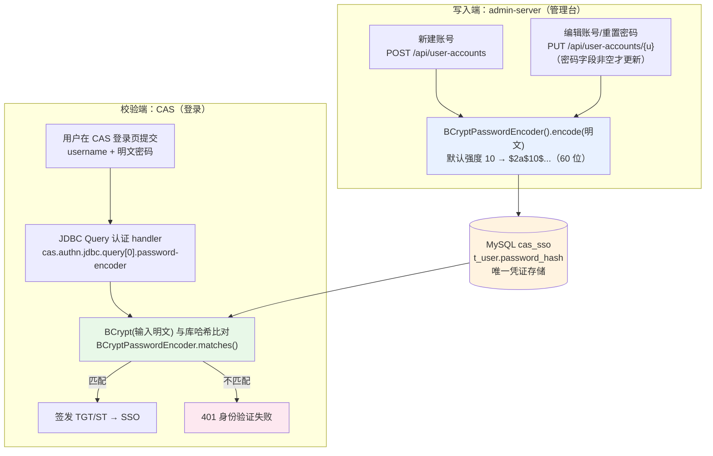

# 密码加密机制与问题处理记录

> 范围：SSO 单点登录体系中「密码」的完整生命周期——生成（admin-server）、存储（MySQL `t_user.password_hash`）、校验（CAS 登录认证）。
> 记录两个已处理问题：① BCrypt 强度 16 导致登录每次卡 4 秒（2026-10-24 定位并修复）；② 演示账号哈希被管理台重置导致的"凭据无效"（同日）。
> 生成日期：2026-10-24。

## 目录

- [一、体系总览：密码的生命周期](#一体系总览密码的生命周期)
- [二、各端实现细节](#二各端实现细节)
- [三、问题 1：登录每次卡 4~5 秒（BCrypt 强度 16）](#三问题-1登录每次卡-45-秒bcrypt-强度-16)
- [四、问题 2：登录提示"凭据无效"（哈希被管理台重置）](#四问题-2登录提示凭据无效哈希被管理台重置)
- [五、两端"同步调整强度"的正确姿势](#五两端同步调整强度的正确姿势)
- [六、速查与排错清单](#六速查与排错清单)

---

## 一、体系总览：密码的生命周期



三端分工：

| 端 | 职责 | 密码相关实现 |
|---|---|---|
| **admin-server** | 生成哈希（只写不读） | [UserAccountService.java:28](admin-server/src/main/java/com/example/admin/service/UserAccountService.java#L28) `new BCryptPasswordEncoder()`（Spring 默认强度 10） |
| **MySQL** | 存储 | `t_user.password_hash`，60 位 BCrypt 字符串 |
| **CAS** | 校验（登录时） | `application.yml` 的 `cas.authn.jdbc.query[0].password-encoder` |

关键规则：**哈希只在 admin-server 生成，只在 CAS 校验；没有任何端能"读出"明文。**
管理台重置密码立即影响 CAS 登录，因为两端读写同一张表。

## 二、各端实现细节

### 2.1 admin-server（生成侧）

```java
// UserAccountService.java:28 —— 无参构造 = Spring Security 默认 strength 10
private static final BCryptPasswordEncoder PASSWORD_ENCODER = new BCryptPasswordEncoder();
```

- **新建**（`create():101`）：`encode(明文)` → INSERT；
- **重置**（`update():118-121`）：`request.password()` 非空才走 `UPDATE ..._WITH_PASSWORD_SQL`；留空表示不改密码；
- 产出示例：`$2a$10$SH9Q62IEaJOWP30B5AFUPOcgILl6HiApzGe6nLNNDjA3UVYL9WsGy`；
- 校验密码规则：8–64 位（`validatePassword`）。

### 2.2 BCrypt 哈希的自描述结构

```
$2a$10$SH9Q62IEaJOWP30B5AFUPOcgILl6HiApzGe6nLNNDjA3UVYL9WsGy
│ │  │ └──────────── 22 位 salt + 31 位 hash ────────────┘
│ │  └─ cost factor = 10（强度编码在字符串内！）
│ └─ 版本（2a）
└─ 标识符
```

**要点：校验端 `matches()` 读取哈希内嵌的 cost，用同样强度重算比对——不使用校验端自己配置的 strength。**
因此强度不一致不会导致"登录失败"，只会导致"校验耗时按哈希内嵌强度走"。

### 2.3 CAS（校验侧，当前生效配置）

```yaml
# application.yml → cas.authn.jdbc.query[0].password-encoder
type: BCRYPT
strength: 10     # 2026-10-24 显式添加；不写时 CAS 7.3 默认 = 16（见问题 1）
```

`strength` 的语义：**CAS 侧生成/重算 BCrypt 时使用的强度**。对"校验已有哈希"这个动作，
实际强度取哈希内嵌值（$2a$10$ → 按 10 算）；该参数更多影响 CAS 需要自行 encode 的场景
（如 `transformPassword` 路径）与将来校验 `$2a$16$` 哈希时的耗时。

## 三、问题 1：登录每次卡 4~5 秒（BCrypt 强度 16）

### 现象

CAS 登录页每次提交凭证，浏览器转圈约 4~5 秒才出结果；GET 登录页（45ms）与
`/p3/serviceValidate`（26ms）都很快，慢的只有 POST 认证这一跳。冷热无差异（排除连接池与 JIT）。

### 定位过程（四步取证法）

1. **分段计时**：

   | 阶段 | 耗时 |
   |---|---|
   | GET 登录页（拿 execution） | ~45 ms |
   | **POST 认证** | **~4000 ms（恒定）** |
   | serviceValidate | ~26 ms |

2. **排除数据库**：JDBC 建连基准测试，`localhost` 与 `127.0.0.1` 首连 ~240ms、热连接 2ms——排除 DNS/建连。

3. **线程转储实锤**：POST 期间连抓多帧 `jcmd <pid> Thread.print`，认证工作线程（`https-jsse-nio-8083-exec-*`）
   稳定停在：

   ```
   at org.springframework.security.crypto.bcrypt.BCrypt.key(BCrypt.java:437)
   at BCrypt.crypt_raw → BCrypt.hashpw → BCryptPasswordEncoder.encode
   at AbstractUsernamePasswordAuthenticationHandler.doAuthentication   ← CAS JDBC 认证 handler
   at DefaultAuthenticationManager.authenticate                        ← CAS 认证主链
   ```

   6 帧中 4 帧都在 BCrypt 内 → 约 4 秒几乎全部耗在 BCrypt 计算（CPU 密集，非等待）。

4. **强度基准测试**（本机，spring-security-crypto 6.5.5）：

   | strength | 单次 BCrypt 耗时 |
   |---|---|
   | 10 | 105 ms |
   | 12 | 238 ms |
   | 14 | 950 ms |
   | 15 | 1 904 ms |
   | **16** | **3 829 ms ← 与 4 秒现象吻合** |

5. **根因确认（反编译 CAS 字节码）**：

   ```
   # cas-server-core-api-configuration-model-7.3.8.3.jar
   # org.apereo.cas.configuration.model.core.authentication.PasswordEncoderProperties.<init>
     16: aload_0
     17: bipush 16          ← 默认 strength = 16
     19: putfield strength

   # cas-server-core-authentication-api-7.3.8.3.jar
   # PasswordEncoderUtils：BCRYPT 分支直接 new BCryptPasswordEncoder(getStrength())
   ```

   **CAS 7.x 的 `password-encoder.type: BCRYPT` 默认 strength = 16**（非 Spring Security 默认的 10）。
   每次登录做一次 4 秒的 CPU 密钥拉伸。

### 处理方案

[application.yml](../src/main/resources/application.yml) 显式配置：

```yaml
password-encoder:
  type: BCRYPT
  # CAS 的 BCRYPT 默认 strength=16（单次认证约 4 秒 CPU 计算）；
  # 显式降到 10（约 100ms）——与 admin-server 生成哈希的 $2a$10$ 前缀一致
  strength: 10
```

### 修复后实测

| 指标 | 修复前 | 修复后 |
|---|---|---|
| POST 认证耗时 | ~4 003 ms | **183 ms（22 倍提升）** |
| 登录结果 | 302 + ST 签发正常 | 302 + ST 签发正常（不变） |

### 遗留取舍

- 强度 10 是行业基线（2026 年单机 ~100ms）；生产如需更高等级建议 **12**（~240ms/次，仍可接受），
  并**与 admin-server 写入端同步**（见第五节）；
- 强度只影响**登录时延**与离线爆破成本，不影响已有哈希的可用性（见 2.2 自描述特性）。

## 四、问题 2：登录提示"凭据无效"（哈希被管理台重置）

### 现象

修复问题 1 的过程中，登录 `alice / Passw0rd!` 返回 401「身份验证失败」——但此前刚验证过该密码可用。

### 定位

1. 全新会话（清 Cookie）重试仍 401 → 排除 webflow/会话干扰；
2. 直查数据库：

   ```sql
   SELECT username, LEFT(password_hash, 10), LENGTH(password_hash) FROM t_user;
   -- alice  $2a$10$7M.  60     ← 前缀与之前重置的 SH9 不同！
   -- bob    $2a$10$SH9  60
   ```

3. 用 spring-security-crypto 实测匹配性：`matches("Passw0rd!", alice当前哈希) = false`。

**根因**：管理台「用户管理」的编辑功能走 [UserAccountService.update():118-121](admin-server/src/main/java/com/example/admin/service/UserAccountService.java#L118-L121)，
**密码字段填写即重置**——此前的管理台联调测试把 alice 的密码改成了非 `Passw0rd!` 的值，
且该改动立即生效于 CAS 登录（两端共享 `t_user`）。

### 处理

```sql
UPDATE t_user SET password_hash = '$2a$10$SH9Q62IEaJOWP30B5AFUPOcgILl6HiApzGe6nLNNDjA3UVYL9WsGy'
WHERE username = 'alice';   -- 该哈希对应 Passw0rd!（生成脚本见第六节）
```

### 经验教训

- 管理台测试**不要用 alice/bob 等共享演示账号**验证"重置密码"功能，造临时账号（如 `uitestuser`）用完即删；
- 遇到"凭据无效"先做三件事：① 看哈希前缀是否变化；② `matches()` 实测；③ 查 `t_login_audit`/CAS 日志
  的 `AUTHENTICATION_FAILED`——区分"密码真的不对"与"认证链路故障"。

## 五、两端"同步调整强度"的正确姿势

**两端 = 生成端（admin-server）+ 校验端（CAS）**。

先纠正一个常见误解：**BCrypt 自描述格式决定了"不同步也能登录"**——
`matches()` 按哈希内嵌 cost 计算，CAS 配 16 校验 `$2a$10$` 哈希照样通过（按 10 跑）。
"同步"的意义是**安全语义一致**：写入端承诺的爆破成本 = 校验端认可的计算强度，避免出现
"写入端以为很高、实际存量哈希仍低"的认知偏差。

### 若要升到强度 12，需要动三处

| # | 位置 | 改动 | 说明 |
|---|---|---|---|
| 1 | [admin-server UserAccountService.java:28](admin-server/src/main/java/com/example/admin/service/UserAccountService.java#L28) | `new BCryptPasswordEncoder(12)` | 新建/重置密码开始产出 `$2a$12$` |
| 2 | CAS `application.yml` | `password-encoder.strength: 12` | 语义对齐（实际校验强度仍由哈希内嵌 cost 决定） |
| 3 | **存量哈希迁移策略** | 见下 | 库中 `$2a$10$` 哈希不会自动升级 |

### 存量哈希迁移的三种策略

| 策略 | 做法 | 适用 |
|---|---|---|
| **自然滚动（推荐）** | 不迁移；用户下次改密时 admin-server 以新强度重写 | 零风险、零成本；老哈希继续按 10 校验 |
| 强制过期 | 通知全员重置密码 | 安全事件后 |
| 一次性重编码 | 需要全部明文（仅可能在双写过渡期收集），实践中通常不可行 | 几乎不用 |

### 本项目当前定档

| 端 | 强度 | 依据 |
|---|---|---|
| admin-server | 10（Spring 默认） | 生成哈希 `$2a$10$` |
| CAS | 10（2026-10-24 显式配置） | 校验时延 ~100ms，登录体验优先；演示环境足够 |

生产升 12 时按上表三处同步，并先在测试环境压测登录时延。

## 六、速查与排错清单

### 工具命令

```powershell
# 1. 生成指定密码的 BCrypt 哈希（复用 admin-server 依赖的 spring-security-crypto）
#    BcryptGen.java: System.out.println(new BCryptPasswordEncoder().encode("明文"));
javac -cp spring-security-crypto-6.5.5.jar BcryptGen.java
java  -cp ".;spring-security-crypto-6.5.5.jar;spring-jcl-*.jar" BcryptGen

# 2. 验证明文与哈希是否匹配（排"凭据无效"第一步）
#    Bc2.java: System.out.println(new BCryptPasswordEncoder().matches("明文", args[0]));
java -cp ".;spring-security-crypto-6.5.5.jar;spring-jcl-*.jar" Bc2 '<库里的哈希>'
# 注意：运行时 classpath 必须带 spring-jcl（BCryptPasswordEncoder 内部用 commons-logging）

# 3. 不同强度的耗时基准（判断"慢"是否来自强度）
#    BcryptBench2.java: 循环 BCrypt.hashpw(pw, BCrypt.gensalt(strength))
#    参考值（本机）：10≈105ms 12≈238ms 14≈950ms 15≈1900ms 16≈3830ms
```

```sql
-- 4. 直查哈希状态（前缀即强度：$2a$10$ = 强度 10）
SELECT username, LEFT(password_hash, 10) AS prefix, LENGTH(password_hash) AS len
FROM cas_sso.t_user;
```

### 症状 → 根因速查

| 症状 | 先查 | 常见根因 |
|---|---|---|
| 登录每次都慢 4 秒上下 | CAS 认证线程转储是否停在 `BCrypt.key` | CAS BCRYPT 默认 strength=16 → 配 `strength: 10` |
| 登录慢但只有第一次 | 建连/JIT | 连接池冷启动，热身后应恢复 |
| 突然"凭据无效"（曾可用） | 哈希前缀是否变化 + `matches()` 实测 | 管理台重置过密码（两端共享 t_user） |
| 登录 500 而非 401 | erp-server/CAS 日志 | 与密码无关，看堆栈 |
| 重置密码后立即生效？ | —— | 是：admin-server 写库，CAS 实时读库，无缓存 |

### 关键文件索引

| 文件 | 角色 |
|---|---|
| [admin-server UserAccountService.java](../admin-server/src/main/java/com/example/admin/service/UserAccountService.java) | 哈希生成（encode，强度 10） |
| [CAS application.yml](../src/main/resources/application.yml) | 校验配置（`password-encoder.strength: 10`） |
| [admin-server pom.xml](../admin-server/pom.xml) | spring-security-crypto 6.5.5 |
| [db/seed.sql](../db/seed.sql) | 演示账号初始哈希 |

---

*记录基于 cas-sso 1.0.0-SNAPSHOT / CAS 7.3.8.3 / spring-security-crypto 6.5.5 实测整理。*
